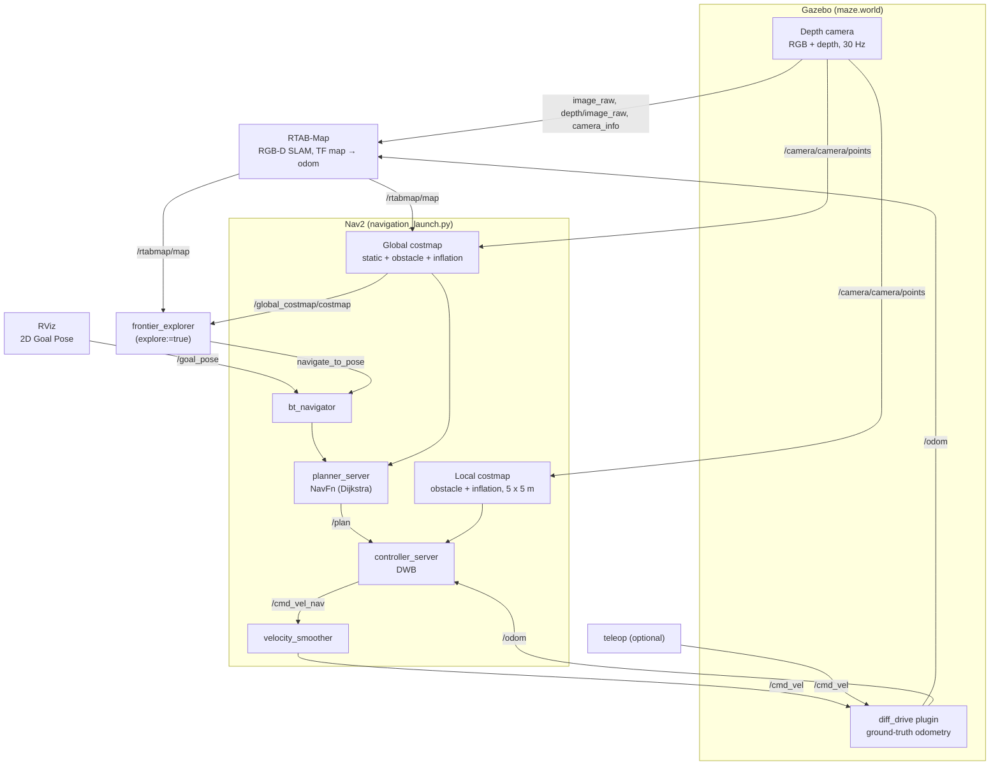

# depth package: Rover Mapping & Navigation

**Owner:** Soham · **Last updated:** 29 Oct 2026 · ROS 2 Humble · Gazebo Classic · RTAB-Map 0.23 · Nav2

## Contents

- [Start here: run the bot](#start-here-run-the-bot)
  - [Workspace setup (first time)](#workspace-setup-first-time)
  - [Build and terminal setup](#build-and-terminal-setup)
  - [Simulation: mapping + Nav2 + frontier exploration](#simulation-mapping--nav2--frontier-exploration)
  - [Real robot: camera mapping + Nav2](#real-robot-camera-mapping--nav2)
- [1. Overview](#1-overview)
  - [1.1 At a glance](#11-at-a-glance)
- [2. Running notes](#2-running-notes)
- [3. Package layout](#3-package-layout)
- [4. Robot model (urdf/rover.urdf)](#4-robot-model-urdfroverurdf)
  - [4.1 Key dimensions](#41-key-dimensions) · [4.2 Links and joints](#42-links-and-joints) · [4.3 Gazebo plugins and sensors](#43-gazebo-plugins-and-sensors) · [4.4 Contact and friction](#44-contact-and-friction)
- [5. System architecture](#5-system-architecture)
  - [5.1 TF tree](#51-tf-tree) · [5.2 Data flow](#52-data-flow) · [5.3 Topics](#53-topics)
- [6. Mapping configuration (RTAB-Map)](#6-mapping-configuration-rtab-map)
  - [6.1 Key mapping values](#61-key-mapping-values) · [6.2 Launch arguments](#62-launch-arguments) · [6.3 Health check](#63-health-check)
- [7. Navigation configuration (Nav2)](#7-navigation-configuration-nav2)
  - [7.1 Key navigation values](#71-key-navigation-values) · [7.2 Servers](#72-servers) · [7.3 Obstacle sensing](#73-obstacle-sensing-point-cloud) · [7.4 DWB controller](#74-dwb-controller-followpath) · [7.5 Costmaps](#75-costmaps) · [7.6 Frontier exploration](#76-frontier-exploration)
- [8. Tuning reference](#8-tuning-reference)
  - [8.1 Verification commands](#81-verification-commands)
- [9. Real robot (D435i depth camera)](#9-real-robot-d435i-depth-camera)
  - [9.1 Real-mode notes](#91-real-mode-notes)
  - [9.2 Stereo IR mode (lower latency)](#92-stereo-ir-mode-lower-latency)
  - [9.3 Real robot dimensions](#93-real-robot-dimensions)
- [10. Known issues and next steps](#10-known-issues-and-next-steps)
  - [10.1 Open issues](#101-open-issues) · [10.2 Troubleshooting](#102-troubleshooting) · [10.3 Next steps](#103-next-steps)

---

## Start here: run the bot

Every command to run the bot is collected here. The sections after this one explain what each part does.

### Workspace setup (first time)

This repository is only the `depth` package. It goes in the `src` folder of a colcon workspace; the commands in this README use `~/depth_mapping`:

```text
~/depth_mapping/           colcon workspace
├── src/
│   └── depth/             this repository
└── build/  install/  log/ created by colcon build
```

Needed first: ROS 2 Humble with Gazebo Classic (`gazebo_ros_pkgs`), and RTAB-Map 0.23 built from source in its own workspace, `~/rtabmap_ws` (see [rtabmap_ros](https://github.com/introlab/rtabmap_ros/tree/ros2)).

```bash
mkdir -p ~/depth_mapping/src
cd ~/depth_mapping/src
git clone <repository-url> depth        # the folder must be src/depth
cd ~/depth_mapping
source /opt/ros/humble/setup.bash
source ~/rtabmap_ws/install/setup.bash
sudo rosdep init                         # only if rosdep was never initialised
rosdep update
rosdep install --from-paths src --ignore-src -y --skip-keys "rtabmap_launch rtabmap_util"
```

`rosdep` installs the apt dependencies listed in `package.xml` (Nav2, ros2_control, RealSense driver, IMU filter, Python packages). RTAB-Map is skipped because it comes from `~/rtabmap_ws`. Then build as below.

### Build and terminal setup

Build once, and again after any change in `src/depth`: launch files are read from `install/`, not from `src/`.

```bash
cd ~/depth_mapping
source /opt/ros/humble/setup.bash
source ~/rtabmap_ws/install/setup.bash
colcon build --packages-select depth
```

Start every terminal below with:

```bash
cd ~/depth_mapping
source ~/rtabmap_ws/install/setup.bash
source install/setup.bash
```

### Simulation: mapping + Nav2 + frontier exploration

Start the terminals in this order:

| Terminal | Command | Notes |
| --- | --- | --- |
| **1. Gazebo + robot** | `ros2 launch depth 2_gazebo.launch.py` | Gazebo, maze, rover, RViz, ros2_control controllers |
| **2. RTAB-Map** | `ros2 launch depth rtabmap.launch.py` | Start after the rover has spawned |
| **3. Nav2 + exploration** | `ros2 launch depth nav2.launch.py` | Exploration starts by itself (`explore:=auto`). For 2D Goal Pose instead: add `explore:=false` |
| **4. Teleop (optional)** | `ros2 run teleop_twist_keyboard teleop_twist_keyboard --ros-args -p speed:=0.15 -p turn:=0.3` | Only with `explore:=false`; keep idle while Nav2 drives |

- Exploration stops when no frontier is left; watch the log for `Exploration complete` ([section 7.6](#76-frontier-exploration)).
- Add `gui:=false` to terminal 1 for Gazebo without windows (no RViz).
- RTAB-Map deletes `~/.ros/rtabmap.db` on every start, so each run maps from scratch.

### Real robot: camera mapping + Nav2

One-time setup: install the IMU filter:

```bash
sudo apt install ros-humble-imu-filter-madgwick
```

Start the terminals in this order:

| Terminal | Command | Notes |
| --- | --- | --- |
| **1. Camera + TF** | `ros2 launch depth real_sensors.launch.py cam_z:=0.4` | Set `cam_*` to the real mount ([section 9.3](#93-real-robot-dimensions)). Lower latency: add `camera_mode:=stereo` here and in terminal 2 ([section 9.2](#92-stereo-ir-mode-lower-latency)) |
| **2. RTAB-Map** | `ros2 launch depth rtabmap.launch.py mode:=real` | After the camera stream is up |
| **3. Nav2** | `ros2 launch depth nav2.launch.py mode:=real` | After `/rtabmap/map` appears. Exploration is off here (`explore:=auto`); `explore:=true` turns it on (untested, see below) |
| **4. RViz2** | `rviz2 -d /opt/ros/humble/share/nav2_bringup/rviz/nav2_default_view.rviz` | Set the Map display topic to `/rtabmap/map` |

> **Real robot status**
> - **Tested:** the real D435i depth camera with RTAB-Map mapping and the Nav2 costmaps, with the camera held in the hand. Nav2 is set up for real mode (`config/nav2_params_real.yaml`).
> - **Not tested yet:** Nav2 driving the actual robot and frontier exploration (`explore:=true`) with the real camera on the robot. `nav2_params_real.yaml` also still lacks the exploration settings ([section 10.1](#101-open-issues)).

---

## 1. Overview

`depth` is a ROS 2 Humble package that simulates a wheeled rover in Gazebo Classic, maps a maze with RTAB-Map using a depth camera, and navigates it autonomously with Nav2. By default a frontier exploration node drives the rover to the edges of the known map until the maze is mapped ([section 7.6](#76-frontier-exploration)); with exploration off, a 2D Goal Pose in RViz drives it through the maze without collisions; map quality is still being tuned (see [section 10](#10-known-issues-and-next-steps)). Mapping and Nav2 also run on a real Intel RealSense D435i depth camera ([section 9](#9-real-robot-d435i-depth-camera)); Nav2 and frontier exploration on the real robot are not tested yet.

### 1.1 At a glance

| Item | Details |
| --- | --- |
| **Robot** | Simulation: differential-drive base (2 drive wheels + 2 castors) carrying a 4-legged body (12 position-controlled joints), a depth camera, an IMU and a placeholder lidar link. |
| **World** | `worlds/maze.world`: 10 × 10 m maze, 1.2 m walls, corridors about 1.85 m wide |
| **Spawn pose** | (-4, -4, 0.15) |
| **Mapping** | RTAB-Map 0.23 (built from source in `~/rtabmap_ws`), RGB-D mode, loop closure disabled |
| **Odometry** | Gazebo ground truth from the diff_drive plugin (`odometry_source 1`) |
| **Navigation** | Nav2 `navigation_launch.py` (no map_server / AMCL), NavFn (Dijkstra) planner, DWB controller |
| **Exploration** | `frontier_explorer` node (started by `nav2.launch.py`): sends Nav2 goals to frontiers of `/rtabmap/map` until none is left |
| **Obstacle sensing** | Depth point cloud (`/camera/camera/points`) read directly by the costmap obstacle layers (60° forward view) |
| **Package** | `ament_python`; workspace `~/depth_mapping`, package `src/depth` |

---

## 2. Running notes

The commands are in [Start here](#start-here-run-the-bot) at the beginning of this README. Notes for running them:

- The rover starts exploring on its own once Nav2 and the map are up, and stops when no frontier is left ([section 7.6](#76-frontier-exploration)).
- To drive with **2D Goal Pose** in RViz instead, start Nav2 with `ros2 launch depth nav2.launch.py explore:=false`.
- In teleop, `q` / `z` raise / lower speed by 10%; the start values are not a hard cap.
- RTAB-Map deletes `~/.ros/rtabmap.db` on every start, so each run maps from scratch.
- Real-robot details are in [section 9](#9-real-robot-d435i-depth-camera).

---

## 3. Package layout

All launch, config, URDF, mesh and world files are installed to `install/depth/share/depth/` by `setup.py`.

| Path | Purpose |
| --- | --- |
| **Launch** | |
| `launch/2_gazebo.launch.py` | Gazebo + maze, robot_state_publisher, RViz, spawns the robot, starts the ros2_control controllers. Fills `DEPTH_SHARE_DIR` and `package://depth` in the URDF. `gui:=false` runs gzserver only |
| `launch/rtabmap.launch.py` | Includes `rtabmap_launch/rtabmap.launch.py` with topics, frames and RTAB-Map parameters; `mode:=sim` (default) or `mode:=real` |
| `launch/nav2.launch.py` | Includes Nav2 `navigation_launch.py` with `config/nav2_params.yaml` (sim) or `config/nav2_params_real.yaml` (`mode:=real`), and starts `frontier_explorer` (`explore:=auto`: on in sim, off in real) |
| `launch/real_sensors.launch.py` | Real robot: D435i driver, Madgwick IMU filter, static TFs, downsampled obstacle cloud |
| `launch/display.launch.py` | RViz-only model view (robot_state_publisher + RViz, no joint state source) |
| **Config** | |
| `config/nav2_params.yaml` | DWB controller, goal checker, global and local costmaps |
| `config/nav2_params_real.yaml` | Real-robot copy: no sim time, `/camera/obstacle_cloud`, D435i ranges, slower turns, looser TF tolerances |
| `config/realsense_emitter_off.yaml` | RealSense `config_file` that turns off the IR emitter (`real_sensors.launch.py camera_mode:=stereo emitter:=0`) |
| `config/controllers.yaml` | ros2_control at 100 Hz: `joint_state_broadcaster` + `joint_group_controller` (position, 12 leg joints) |
| **Model & world** | |
| `urdf/rover.urdf` | The simulated robot model: wheeled base + legs, sensors, Gazebo plugins, friction |
| `meshes/*.stl` | Body (`body-v1`) and 12 leg-segment meshes, in millimetres (scaled 0.001) |
| `worlds/maze.world` | The maze used by `2_gazebo.launch.py` |
| **Nodes** | |
| `depth/frontier_explorer.py` | Frontier exploration node (`ros2 run depth frontier_explorer`); parameters have built-in defaults, see [section 7.6](#76-frontier-exploration) |
| **Other** | |
| `depth/__init__.py` | Python package marker |
| `test/` | Standard ament copyright, flake8 and pep257 tests |
| Unused | `config/pointcloud_to_laserscan.yaml` (old point cloud → `/scan` conversion), `urdf/urdf.urdf`, `urdf/urdf.sdf`, `urdf/model.config` (old legs-only model), `worlds/A1.world`, `worlds/model.sdf` |

---

## 4. Robot model (urdf/rover.urdf)

### 4.1 Key dimensions

| Property | Value |
| --- | --- |
| **Total mass** | 17.8 kg |
| **Centre of gravity** | 0.19 m above ground |
| **Forward direction** | +x of `base_link` |
| **Outline (top view)** | x -0.26 to +0.21 m (rear feet to camera), y ±0.18 m (wheels) |
| **base_link** | 0.2 × 0.2 × 0.1 m box, 2 kg, 0.10 m above ground |
| **Drive wheels** | radius 0.05 m, width 0.06 m, separation 0.30 m |
| **Camera** | 0.2 m forward, 0.4 m above `base_link`, facing +x |
| **Legs** | Lowest point 0.23 m above ground at zero pose (do not touch the floor) |

### 4.2 Links and joints

| Joint | Type | Parent → child | Origin xyz / rpy | Notes |
| --- | --- | --- | --- | --- |
| `base_footprint_joint` | fixed | base_footprint → base_link | 0 0 0 / 0 0 0 | base_link sits 0.10 m above ground |
| `wheel_front_left_joint` | continuous | base_link → wheel_front_left | 0 0.15 -0.05 / -1.5708 0 0 | 2 kg; axis +y |
| `wheel_front_right_joint` | continuous | base_link → wheel_front_right | 0 -0.15 -0.05 / -1.5708 0 0 | Same as left |
| `castor_wheel_joint` | fixed | base_link → front_castor_wheel | -0.15 0 -0.05 / 1.57 0 0 | Sphere, visual r 0.05, collision r 0.048, 2 kg. Sits at the rear despite its name |
| `castor_wheel_joint_2` | fixed | base_link → back_castor_wheel | 0.15 0 -0.05 / 1.57 0 0 | Same, at the front |
| `camera_joint` | fixed | base_link → camera | 0.2 0 0.4 / 0 0 0 | 0.025 × 0.09 × 0.025 m, 0.5 kg |
| `camera_optical_joint` | fixed | camera → camera_link_optical | 0 0 0 / -1.5708 0 -1.5708 | Optical convention: z forward, x right, y down |
| `imu_joint` | fixed | base_link → imu_link | 0 0 0.2 / 0 0 0 | 0.1 kg |
| `lidar_joint` | fixed | base_link → lidar | 0 0 0.5 / 0 0 1.57 | Frame only, no sensor plugin |
| `botbase` | fixed | base_link → body-v1 | 0 0.05 0.3 / 0 0 3.14 | Leg body mesh, 2.54 kg |
| `CCUP1`–`CCUP4` | revolute | body-v1 → legX1 | hip yaw | ±3.14 rad, 50 Nm, 5 rad/s, damping 0.2 |
| `THIGH1`–`THIGH4` | revolute | legX1 → legX2 | thigh | Same limits |
| `FOOT1`–`FOOT4` | revolute | legX2 → legX3 | foot | Same limits |

The 12 leg joints are position-controlled through `/joint_group_controller/commands`. Nothing in the mapping and navigation setup commands them; the rover drives on its wheels.

### 4.3 Gazebo plugins and sensors

| Plugin | Key settings | Publishes |
| --- | --- | --- |
| **gazebo_ros2_control** | Parameters from `DEPTH_SHARE_DIR/config/controllers.yaml` (path filled by the launch file) | `/controller_manager` services; `/joint_states` via joint_state_broadcaster |
| **diff_drive** | wheel_separation 0.30, wheel_diameter 0.10, max_wheel_torque 20, max_wheel_acceleration 2.0, odometry_source 1 (ground truth), odometry_frame `odom`, robot_base_frame `base_footprint` | `/odom`, TF odom → base_footprint, wheel TFs; subscribes `/cmd_vel` |
| **Depth camera** | 30 Hz, 640 × 480, HFOV 1.047 rad (60°), clip 0.05–10 m, namespace `/camera`, frame `camera_link_optical` | `/camera/camera/image_raw`, `…/depth/image_raw`, `…/points`, camera_info |
| **IMU** | 100 Hz, gaussian noise (gyro 0.0002, accel 0.017), frame `imu_link` | `/imu/data` |

### 4.4 Contact and friction

| Part | Setting | Reason |
| --- | --- | --- |
| **Castors** | `mu1 = mu2 = 0` | Slide instead of dragging |
| **Drive wheels** | `mu1 = mu2 = 1.0`, `kp 1e6`, `kd 100`, `minDepth 0.001` | Firm grip, no sinking |
| **Castor collision** | r 0.048 (2 mm smaller than visual) | Drive wheels carry the weight and keep their grip |

> [!WARNING]
> **URDF rules that break things**
> - Friction must go in `<gazebo reference>` blocks; URDF `<contact_coefficients>` tags are ignored by Gazebo.
> - Never put a colon followed by a space anywhere in the URDF, comments included. gazebo_ros2_control passes the URDF as a YAML parameter and the plugins silently fail to load.

---

## 5. System architecture

### 5.1 TF tree

Only two transforms move with the robot's position: **map → odom** from RTAB-Map and **odom → base_footprint** from Gazebo's diff_drive. Everything below `base_link` comes from robot_state_publisher, which also turns `/joint_states` into the 12 leg transforms.

```text
map
└── odom                                  map → odom: RTAB-Map correction (dynamic, should stay near 0)
    └── base_footprint                    odom → base_footprint: Gazebo diff_drive (dynamic, ground truth)
        └── base_link                     robot_state_publisher (static, identity); Nav2 robot frame
            ├── wheel_front_left          diff_drive wheel TF (y +0.15, z -0.05, spins)
            ├── wheel_front_right         diff_drive wheel TF (y -0.15, z -0.05, spins)
            ├── front_castor_wheel        static (x -0.15, sits at the rear)
            ├── back_castor_wheel         static (x +0.15, sits at the front)
            ├── imu_link                  static (z 0.2; frame of /imu/data)
            ├── lidar                     static (z 0.5; frame only, no sensor)
            ├── camera                    static (x 0.2, z 0.4, faces +x)
            │   └── camera_link_optical   static (z forward; images and /camera/camera/points)
            └── body-v1                   static (y 0.05, z 0.3, yaw 180°; leg body)
                ├── leg11 → leg12 → leg13 CCUP1, THIGH1, FOOT1   (robot_state_publisher from /joint_states)
                ├── leg21 → leg22 → leg23 CCUP2, THIGH2, FOOT2
                ├── leg31 → leg32 → leg33 CCUP3, THIGH3, FOOT3
                └── leg41 → leg42 → leg43 CCUP4, THIGH4, FOOT4
```

- Wheel transforms come from diff_drive (`publish_wheel_tf`) because the wheel joints are not in ros2_control.
- Gazebo merges fixed-joint links into one body, but TF still publishes every frame.
- Check the live tree with `ros2 run tf2_tools view_frames`.

### 5.2 Data flow

The depth camera's output splits two ways: images go to RTAB-Map to build the map, and the point cloud goes straight into the Nav2 costmaps for obstacle avoidance. Nav2 plans on both and sends `/cmd_vel` back to the diff_drive plugin, closing the loop. Goals come from frontier_explorer (default) or from an RViz 2D Goal Pose (`explore:=false`).



Not drawn: every node also reads `/tf`; frontier_explorer also calls `compute_path_to_pose` (planner_server) and `spin` (behavior_server).

### 5.3 Topics

All nodes run on simulation time (`/clock` from Gazebo).

| Topic | Type | Publisher | Subscribers |
| --- | --- | --- | --- |
| **Sensors** | | | |
| `/camera/camera/image_raw` | Image | Depth camera | RTAB-Map |
| `/camera/camera/depth/image_raw` | Image (32FC1, m) | Depth camera | RTAB-Map |
| `/camera/camera/camera_info` | CameraInfo | Depth camera | RTAB-Map |
| `/camera/camera/points` | PointCloud2 | Depth camera | Costmap obstacle layers, RViz |
| `/imu/data` | Imu | IMU plugin | Not used yet |
| `/odom` | Odometry | diff_drive (ground truth) | RTAB-Map, Nav2 controller, velocity smoother |
| **Robot state** | | | |
| `/joint_states` | JointState | joint_state_broadcaster | robot_state_publisher |
| `/joint_group_controller/commands` | Float64MultiArray | — | joint_group_controller (leg joint positions) |
| `/robot_description` | String | robot_state_publisher | spawn_entity, RViz |
| `/tf`, `/tf_static` | TFMessage | robot_state_publisher, diff_drive, RTAB-Map | All nodes |
| **Mapping** | | | |
| `/rtabmap/map` | OccupancyGrid | RTAB-Map | Global costmap static layer, frontier_explorer, RViz |
| `/rtabmap/mapGraph`, `/info`, `/mapData` | rtabmap_msgs | RTAB-Map | rtabmap_viz, debugging |
| **Navigation** | | | |
| `/goal_pose` | PoseStamped | RViz 2D Goal Pose | bt_navigator |
| `navigate_to_pose`, `compute_path_to_pose`, `spin` | Nav2 actions | bt_navigator, planner_server, behavior_server | frontier_explorer (client) |
| `/explore/frontiers` | MarkerArray | frontier_explorer | RViz (add it by topic) |
| `/plan` | Path | planner_server | controller_server, RViz |
| `/global_costmap/costmap`, `/local_costmap/costmap` | OccupancyGrid | Nav2 costmaps | RViz; frontier_explorer reads the global one |
| `/cmd_vel_nav` | Twist | controller_server (DWB) | velocity_smoother |
| `/cmd_vel` | Twist | velocity_smoother or teleop | diff_drive |

> [!NOTE]
> **One driver at a time.** Teleop and Nav2 both publish on `/cmd_vel`. Any teleop keypress fights Nav2's commands, including the goals frontier exploration sends.

---

## 6. Mapping configuration (RTAB-Map)

RTAB-Map builds the 2D occupancy map from the RGB-D camera and publishes **map → odom**. Because odometry is Gazebo ground truth, the configuration tells RTAB-Map to trust it and stops camera matching from changing it. All values below are set in `launch/rtabmap.launch.py`.

### 6.1 Key mapping values

| Setting | Value | Effect |
| --- | --- | --- |
| `Rtabmap/DetectionRate` | 2 Hz | Map nodes added twice as often as the default (1 Hz); no gaps while moving |
| `RGBD/LinearUpdate` | 0.05 m | New node after 5 cm of travel |
| `RGBD/AngularUpdate` | 0.05 rad | New node after ~3° of rotation |
| `Grid/Sensor` | 1 (depth) | Occupancy grid built from the depth camera |
| `Grid/RayTracing` | true | Free space cleared along each depth ray |
| `Grid/3D` | false | 2D occupancy grid for Nav2 |
| `Reg/Force3DoF` | true | Solve only x, y, yaw: map cannot tilt or lift |
| `RGBD/NeighborLinkRefining` | false | Keeps the perfect odometry between consecutive nodes |
| `RGBD/ProximityBySpace` | false | No proximity links (caused 22–44° rotation errors on plain walls) |
| `Kp/MaxFeatures` | -1 | Loop closure disabled: identical corridors gave false closures ~2.85 m off |
| `--delete_db_on_start` | flag | Fresh map each launch |

> [!IMPORTANT]
> **Parameters must go inside `args`.** `rtabmap_launch` silently ignores launch arguments it does not declare. Every RTAB-Map parameter (e.g. `--Grid/Sensor 1`) must be inside the `args` string, not passed as its own launch argument. In RTAB-Map 0.23, `Grid/Sensor` replaces the old `Grid/FromDepth`.

### 6.2 Launch arguments

| Argument | Value |
| --- | --- |
| `rgb_topic` | `/camera/camera/image_raw` |
| `depth_topic` | `/camera/camera/depth/image_raw` |
| `camera_info_topic` | `/camera/camera/camera_info` |
| `odom_topic` | `/odom` (`visual_odometry` false) |
| `frame_id` / `odom_frame_id` / `map_frame_id` | `base_footprint` / `odom` / `map` |
| `publish_tf_map` | true |
| `approx_sync` / `approx_sync_max_interval` / `queue_size` | true / 0.1 s / 30 |
| `depth` / `subscribe_rgb` | true / true (RGB-D mode) |
| `use_sim_time` | true |
| `rtabmap_viz` / `rviz` | true / false (uses the RViz from terminal 1) |

### 6.3 Health check

With ground-truth odometry, map → odom should stay close to zero. A growing offset means wrong camera matches are bending the map (seen as doubled, rotated walls):

```bash
ros2 run tf2_ros tf2_echo map odom
```

---

## 7. Navigation configuration (Nav2)

Nav2 runs from `navigation_launch.py` without map_server or AMCL: RTAB-Map supplies both the map (`/rtabmap/map`) and localisation (map → odom). A goal flows bt_navigator → planner (NavFn) → controller (DWB) → velocity_smoother → `/cmd_vel`. Parameters are in `config/nav2_params.yaml`.

### 7.1 Key navigation values

| Setting | Value | Where / why |
| --- | --- | --- |
| **Motion limits** | | |
| `max_vel_x` / `max_speed_xy` | 0.15 m/s | DWB; slow enough for the camera to map as it drives |
| `max_vel_theta` | 0.5 rad/s | DWB in-place turn limit |
| `acc_lim_x` / `acc_lim_theta` | 1.0 / 1.5 | DWB acceleration limits |
| `decel_lim_x` / `decel_lim_theta` | -1.5 / -2.0 | DWB deceleration limits |
| velocity_smoother `max_velocity` | 0.15 m/s, 0.5 rad/s | Same as DWB, so nothing upstream can go faster |
| behavior_server `max_rotational_vel` / `rotational_acc_lim` | 0.5 rad/s / 1.5 | Spins (recoveries, exploration look-around) bypass DWB and the smoother; capped to the DWB values |
| **Goal** | | |
| `xy_goal_tolerance` | 0.25 m | SimpleGoalChecker (stateful) |
| `yaw_goal_tolerance` | 0.25 rad | ~14° |
| **Robot shape & clearance** | | |
| `footprint` | `[[0.23, 0.19], [0.23, -0.19], [-0.27, -0.19], [-0.27, 0.19]]` | Measured from URDF meshes (rear feet to camera) |
| `footprint_padding` | 0.02 m | Both costmaps |
| `inflation_radius` | 0.55 m | > footprint outer radius (~0.36 m); still leaves a lane in 1.85 m corridors |
| `cost_scaling_factor` | 2.0 | Gentle cost fall-off keeps paths near corridor centres |
| **Sensing** | | |
| `obstacle_max_range` / `raytrace_max_range` | 3.0 / 4.0 m | Mark up to 3 m, clear up to 4 m |
| `min_obstacle_height` / `max_obstacle_height` | 0.1 / 0.7 m | In the costmap's global frame (`map` / `odom`); drops floor points, keeps the 1.2 m walls |
| **Rates** | | |
| `controller_frequency` | 10 Hz | controller_server |
| Global / local costmap update | 2 Hz / 5 Hz | Publish at the same rates |

### 7.2 Servers

| Node | Role | Configuration |
| --- | --- | --- |
| `bt_navigator` | Runs navigate-to-pose BT for each `/goal_pose` | Nav2 defaults |
| `planner_server` | Global path on the global costmap | NavFn (`GridBased`), `use_astar` false (Dijkstra), `allow_unknown` true (frontier goals sit next to unknown space) |
| `controller_server` | Follows the path at 10 Hz → `/cmd_vel_nav` | `FollowPath` = `DWBLocalPlanner` + `SimpleGoalChecker`; progress checker 0.5 m in **20 s** (Nav2's 10 s aborted goals behind the rover: a 180° turn alone takes ~8 s and turning is not progress) |
| `velocity_smoother` | Smooths `/cmd_vel_nav` → `/cmd_vel` | Capped at the DWB limits: 0.15 m/s, 0.5 rad/s |
| `behavior_server` | Recovery: spin, back up, wait; also frontier_explorer's 360° spins | Spin capped at the DWB limits (`max_rotational_vel` 0.5 rad/s, `rotational_acc_lim` 1.5; Nav2 defaults 1.0 / 3.2), because spins publish `/cmd_vel` directly and bypass DWB and the smoother. `transform_tolerance` 0.5 s (with 0.1 s, Gazebo TF ~60 ms late made every spin abort with "Collision Ahead") |
| `waypoint_follower` | Multi-goal following | Nav2 defaults |

### 7.3 Obstacle sensing (point cloud)

Both costmap obstacle layers subscribe to `/camera/camera/points` directly as a `PointCloud2` observation source named `depth_cloud`; there is no pointcloud_to_laserscan node and no `/scan` topic.

| Parameter | Value | Why |
| --- | --- | --- |
| `data_type` | `PointCloud2` | Raw depth camera cloud, no 2D conversion |
| `min_obstacle_height` | 0.1 m | Measured in the costmap's global frame (`map` / `odom`), not `base_link`. Keeps floor points out; a window reaching the floor gives a ring of fake obstacles |
| `max_obstacle_height` | 0.7 m | Keeps wall points (walls are 1.2 m) |
| `obstacle_min_range` / `obstacle_max_range` | 0.1 / 3.0 m | Mark up to 3 m |
| `raytrace_min_range` / `raytrace_max_range` | 0.1 / 4.0 m | Clear up to 4 m |
| `marking` / `clearing` | true / true | Clearing only happens along rays that hit a point; bearings with no return are not cleared |

### 7.4 DWB controller (FollowPath)

| Group | Parameters |
| --- | --- |
| **Velocity** | `min_vel_x` 0.0, `max_vel_x` 0.15, `min_speed_xy` 0.0, `max_speed_xy` 0.15, `max_vel_theta` 0.5, `min_speed_theta` 0.0 |
| **Acceleration** | `acc_lim_x` 1.0, `acc_lim_y` 0.0, `acc_lim_theta` 1.5 |
| **Deceleration** | `decel_lim_x` -1.5, `decel_lim_y` 0.0, `decel_lim_theta` -2.0 |
| **Sampling** | `vx_samples` 20, `vy_samples` 1, `vtheta_samples` 20, `sim_time` 1.7 s |
| **Stopping** | `xy_goal_tolerance` 0.25, `trans_stopped_velocity` 0.1, `stateful` true |
| **Evaluation** | `short_circuit_trajectory_evaluation` true |
| **Critic scales** | PathAlign 32, PathDist 32, RotateToGoal 32, GoalAlign 24, GoalDist 24, BaseObstacle 2.0, Oscillation (default) |

### 7.5 Costmaps

| Setting | Global costmap | Local costmap |
| --- | --- | --- |
| **Frame** | `map`, static size | `odom`, rolling 5 × 5 m |
| **robot_base_frame** | `base_link` | `base_link` |
| **Resolution** | 0.05 m | 0.05 m |
| **Update / publish rate** | 2 / 2 Hz | 5 / 5 Hz |
| **Layers** | static (`/rtabmap/map`, `subscribe_to_updates`) → obstacle (`/camera/camera/points`) → inflation | obstacle (`/camera/camera/points`) → inflation |
| **Obstacle ranges** | mark 3.0, clear 4.0, min 0.1 m | mark 3.0, clear 4.0, min 0.1 m |
| **Obstacle height window** | 0.1 to 0.7 m (in `map`) | 0.1 to 0.7 m (in `odom`) |
| **tf_filter_tolerance** | 0.5 s | 0.5 s (+ `transform_tolerance` 0.5 s) |
| **Inflation** | radius 0.55, scaling 2.0 | radius 0.55, scaling 2.0 |
| **Footprint** | measured polygon + 0.02 padding | same |
| **Unknown space** | tracked | — |
| **Publishing** | full costmap every time (`always_send_full_costmap`), read by frontier_explorer | Nav2 default |

### 7.6 Frontier exploration

`depth/frontier_explorer.py` maps the maze without manual goals. A **frontier** is a free cell of `/rtabmap/map` next to unknown space; driving there and looking around turns unknown space into map. The node is started by `nav2.launch.py` (`explore:=auto`: on in sim, off in real, where it is not tested yet) and talks to Nav2 through `nav2_simple_commander`. It waits for Nav2 (`planner_server` active; there is no AMCL), the map, the global costmap and TF, so it can start with Nav2.

**One cycle (1 Hz):**

1. **Find frontier cells**: free cells (0) with an unknown (-1) cell among their 8 neighbours.
2. **Keep the reachable ones**: only frontier cells in the free area 4-connected to the robot. Depth rays leak a little past walls and mark free cells on the other side; this drops them.
3. **Group** neighbouring cells into clusters; drop clusters shorter than `min_frontier_size`.
4. **Goal per cluster**: the free cell nearest the cluster's middle that is at least `goal_offset` from unknown or occupied cells and costs at most `max_goal_cost` in the global costmap, facing the frontier.
5. **Choose**: plan a path to the nearest `max_candidates` goals; score = size − path length − 0.3 × turn (rad); send the best as a NavigateToPose goal.
6. **While driving**: cancel if the frontier gets mapped on the way, or if the robot moves less than 0.1 m in `progress_timeout`.
7. **On arrival**: spin 360° (the camera only sees 60°). If fewer than 10 % of the unknown cells within 1 m of the frontier became known, the camera cannot see it from there (for example behind a wall): blacklist it.
8. **Finish**: when no frontier is left for 3 cycles, log `Exploration complete` and exit. If frontiers are left but all blacklisted, first clear the Nav2-failure blacklist once and retry (a goal that failed from one spot often works from another); then log `Exploration stopped … the map may be incomplete`.

**Blacklists** (within 0.5 m of a frontier): *Nav2 failures* (no path, aborted, no progress) are retried once at the end; *not observable* (visit revealed nothing) are never retried.

| Parameter | Default | Meaning |
| --- | --- | --- |
| `map_topic` / `costmap_topic` | `/rtabmap/map` / `/global_costmap/costmap` | Frontiers come from the map; goal costs from the costmap |
| `global_frame` / `robot_frame` | `map` / `base_link` | |
| `min_frontier_size` | 0.3 m | Shorter clusters are noise (gaps in a wall) |
| `goal_offset` | 0.3 m | Minimum distance from the goal to unknown or occupied cells |
| `goal_search_radius` | 1.0 m | How far from the frontier to look for a goal cell |
| `max_goal_cost` | 60 | Highest global costmap value (0–100) at a goal; 99 = inscribed |
| `size_weight` / `distance_weight` / `turn_weight` | 1.0 / 1.0 / 0.3 | Score = size_weight × size − distance_weight × path − turn_weight × turn |
| `max_candidates` | 5 | Nearest clusters that get a planned path (one planner call each) |
| `planner_frequency` | 1.0 Hz | Frontier search and progress checks |
| `progress_timeout` / `progress_distance` | 30 s / 0.1 m | Cancel and blacklist when the robot stops making progress |
| `frontier_gone_radius` | 0.5 m | Cancel the goal once no frontier cell is left this close to it |
| `spin_on_arrival` / `spin_time_allowance` | true / 40 s | 360° spin at the start and after each goal |
| `visit_check_radius` / `min_visit_gain` | 1.0 m / 0.1 | "Visit revealed nothing" test |
| `blacklist_radius` / `blacklist_retries` | 0.5 m / 1 | Blacklist size; how often Nav2 failures are retried |
| `finish_checks` | 3 | Cycles without a frontier before finishing |

Change a value with `ros2 run depth frontier_explorer --ros-args -p use_sim_time:=true -p min_frontier_size:=0.5` (start Nav2 with `explore:=false` first), or edit the default in the node and rebuild.

**In RViz** add `/explore/frontiers` (MarkerArray): blue points = frontier cells, yellow spheres = candidate goals, green arrow = chosen goal, red discs = blacklisted areas.

**Log lines to expect:** `Next frontier: <size> m long, path <length> m, goal (x, y)`, `Frontier mapped on the way`, `Visit revealed almost nothing … blacklisting the frontier`, `No progress towards the frontier`, `Retrying N frontier(s)`, and finally `Exploration complete` or `Exploration stopped`.

**Speed:** the explorer never sends velocities itself. Driving goes through DWB and the velocity smoother (0.15 m/s, 0.5 rad/s), and the 360° spins through behavior_server, capped at the same 0.5 rad/s; a full spin takes about 16 s (`spin_time_allowance` 40 s).

**Test status (simulation):**

- Frontier detection, goal placement, the reachability filter and both blacklists were checked on synthetic maps.
- In Gazebo the rover explores on its own and recovers from failed goals. The best observed run had mapped **91 %** of the 10 × 10 m maze (an earlier run, before the Nav2 fixes, stopped at 78 %).
- **Not yet confirmed:** a complete run to `Exploration complete` with all current fixes, including the spin speed cap. The test runs before it were cut short.

---

## 8. Tuning reference

Where to look when you want to change behaviour. Rebuild after editing any file.

| If you want to… | Change | File |
| --- | --- | --- |
| Drive slower / faster under Nav2 (and while exploring) | `max_vel_x`, `max_speed_xy`, `max_vel_theta`; keep velocity_smoother `max_velocity` / `min_velocity` and behavior_server `max_rotational_vel` equal to them | `nav2_params.yaml` |
| Turn more gently while mapping | `max_vel_theta` (try 0.3) | `nav2_params.yaml` |
| Keep paths further from walls | `inflation_radius` ↑ or `cost_scaling_factor` ↓ | `nav2_params.yaml` |
| Fit through tighter gaps | `inflation_radius` ↓ (keep > 0.36 m) | `nav2_params.yaml` |
| Stop closer to the goal | `xy_goal_tolerance`, `yaw_goal_tolerance` | `nav2_params.yaml` |
| Ignore low clutter / the floor | `min_obstacle_height` | `nav2_params.yaml` |
| See obstacles further out | `obstacle_max_range` / `raytrace_max_range` | `nav2_params.yaml` |
| Fill gaps in the map | `Rtabmap/DetectionRate` ↑, `RGBD/LinearUpdate` ↓ | `rtabmap.launch.py` |
| Re-enable loop closure | Remove `--Kp/MaxFeatures -1` | `rtabmap.launch.py` |
| Keep an old map between runs | Remove `--delete_db_on_start` | `rtabmap.launch.py` |
| Lower real-robot mapping latency | `camera_mode:=stereo` on both launch files | `real_sensors.launch.py`, `rtabmap.launch.py` |
| Better obstacle depth in stereo mode | `emitter:=1` (costs odometry robustness) | `real_sensors.launch.py` |
| Drive with 2D Goal Pose instead of exploring | `explore:=false` | `nav2.launch.py` |
| Ignore small frontiers / wall gaps | `min_frontier_size` ↑ | `frontier_explorer.py` |
| Prefer close frontiers over big ones | `distance_weight` ↑ or `size_weight` ↓ | `frontier_explorer.py` |
| Explore faster (less looking around) | `spin_on_arrival` false | `frontier_explorer.py` |
| Give Nav2 longer before abandoning a goal | `progress_timeout` ↑ | `frontier_explorer.py` |

### 8.1 Verification commands

```bash
ros2 param get /rtabmap Reg/Force3DoF          # confirm an RTAB-Map value is live
ros2 param get /controller_server FollowPath.max_vel_x
ros2 run tf2_ros tf2_echo map odom             # should stay near zero
ros2 run tf2_tools view_frames                 # dump the TF tree
ros2 topic hz /camera/camera/points           # check the point cloud is flowing
ros2 node list | grep frontier_explorer        # exploration running (exits when done)
ros2 param get /behavior_server transform_tolerance   # 0.5: spins must not abort
```

Real robot latency, to compare `camera_mode:=rgbd` and `camera_mode:=stereo`:

```bash
ros2 topic hz /camera/camera/color/image_raw                   # rgbd input rate
ros2 topic hz /camera/camera/aligned_depth_to_color/image_raw  # rgbd input rate
ros2 topic hz /camera/camera/infra1/image_rect_raw             # stereo input rate
ros2 topic hz /odom                                            # visual odometry output rate
ros2 topic delay /odom                                         # camera stamp -> odometry out
ros2 topic delay /rtabmap/map                                  # map update lag
```

---

## 9. Real robot (D435i depth camera)

The same RTAB-Map and Nav2 launch files take `mode:=real` (default `mode:=sim`, unchanged); `real_sensors.launch.py` provides what Gazebo provides in simulation. The sim's URDF, Gazebo and TF setup are not used. The commands are under [Start here → Real robot](#real-robot-camera-mapping--nav2).

**Tested:** the real depth camera, held in the hand, with RTAB-Map building the map and the Nav2 costmaps building from real depth data. Nav2 runs in real mode with its own parameters (`config/nav2_params_real.yaml`).

**Not tested yet:** Nav2 driving the actual robot to a goal, and frontier exploration, with the real camera mounted on the robot.

### 9.1 Real-mode notes

- Localize on a saved map instead of mapping: `rtabmap.launch.py mode:=real localization:=true`. Keep a map without localizing: `delete_db:=false`.
- Other options: `rtabmap_viz:=false`; `base_height` (base_link above floor, default 0.10); `use_imu` (pass the same value to both launch files).
- Real TF tree: `map → odom → base_footprint → base_link → camera_link → RealSense optical frames`. `map → odom` comes from RTAB-Map, `odom → base_footprint` from rgbd_odometry, and the rest from static publishers and the RealSense driver.
- Differences from sim: loop closure, neighbour refining and proximity links are on (the sim disables them for ground-truth odom); the costmap obstacle range is 0.3–2.5 m; `max_vel_theta` is 0.3 rad/s, and velocity_smoother and recovery spins (`behavior_server`) are capped to match (0.15 m/s / 0.3 rad/s); TF tolerances are 1.0 s.
- Frontier exploration is off in real mode (`explore:=auto`) until it is tested on the robot; `explore:=true` turns it on.
- The footprint and camera mount are still the URDF values; set them for the real robot ([section 9.3](#93-real-robot-dimensions)).

### 9.2 Stereo IR mode (lower latency)

`camera_mode:=stereo` (default `rgbd`) runs RTAB-Map on the D435i's two global-shutter IR images instead of colour + aligned depth. The driver skips depth alignment and the colour stream, and RTAB-Map uses `stereo_sync` + `stereo_odometry`. Add `camera_mode:=stereo` to terminals 1 and 2 under [Start here → Real robot](#real-robot-camera-mapping--nav2) (always both). Nav2 and RViz are unchanged.

- **`emitter`** (stereo only, default `0`): the IR dot projector moves with the camera and creates fake features for stereo odometry, so it is off by default (via `config/realsense_emitter_off.yaml`). Without it the depth on plain, textureless walls gets sparser, which weakens `/camera/obstacle_cloud` for Nav2. Use `emitter:=1` if obstacles get missed.
- **`infra_fps`** (stereo only, default `30`): IR and depth frame rate.
- `/camera/obstacle_cloud` is built from the unaligned `/camera/camera/depth/image_rect_raw` in this mode; Nav2 is unchanged.
- The occupancy grid (`Grid/Sensor 1`) comes from stereo disparity.

### 9.3 Real robot dimensions

Real mode does not read `rover.urdf` (simulation only). Set the real robot's size here, then rebuild:

| What | File and place | How to set it |
| --- | --- | --- |
| **Footprint** | `config/nav2_params_real.yaml`: `footprint` and `footprint_padding` in `global_costmap` and `local_costmap` (keep both equal) | Corners `[x, y]` in metres from the rotation centre, +x forward, +y left: `[[front, left], [front, -right], [-rear, -right], [-rear, left]]`, measured to the outer edges (feet, camera mount) |
| **Inflation** | Same file: `inflation_radius` in both costmaps | Larger than the farthest corner, `sqrt(x² + y²)`, plus 0.1–0.2 m |
| **Camera mount** | `launch/real_sensors.launch.py`: `cam_x`, `cam_y`, `cam_z`, `cam_roll`, `cam_pitch`, `cam_yaw` | Relative to base_link; `cam_z` is above base_link, not the floor; pitch is positive tilting down. Or pass them on the command line |
| **Base height** | Same file: `base_height` | base_link above the floor (base_footprint) |
| **Obstacle heights** | `max_obstacle_height` in both costmaps; `--Grid/MaxObstacleHeight` in `launch/rtabmap.launch.py` | About the robot's height |

Check: the footprint outline in RViz matches the robot, and `ros2 run tf2_ros tf2_echo base_footprint camera_link` shows the measured camera position.

---

## 10. Known issues and next steps

### 10.1 Open issues

- **Map quality not yet confirmed** with loop closure disabled. Check that map → odom stays near zero.
- **No hard speed cap on teleop.** `q` raises speed past the start values. A `cmd_vel_limiter` node (teleop → `/cmd_vel_teleop` → limiter → `/cmd_vel`) is proposed but not implemented.
- **In-place turns** reach about 80% of the commanded rate because the wheels slip slightly; Nav2 compensates through odometry.
- **Narrow sensor view.** The 60° camera sees nothing beside or behind the rover; the `lidar` link has no sensor plugin.
- **Castor names are swapped:** `front_castor_wheel` sits at the rear (x -0.15).
- **Frame mismatch:** Nav2 uses `base_link`, RTAB-Map uses `base_footprint`. Works because the transform between them is identity.
- **DWB can stall in some maze spots:** the controller outputs ~0 m/s although the robot is in free space and can drive under teleop; Nav2's own recoveries (spin, wait, back up) do not get it out. Frontier exploration abandons such goals after 30 s and retries them once at the end.
- **Depth rays leak past walls**, marking free cells on the far side. Exploration ignores those not connected to the robot, and blacklists the rest after one visit.
- **Frontier exploration not yet confirmed end to end:** no complete run to `Exploration complete` with the current settings (see [section 7.6](#76-frontier-exploration)). Blacklists are stored by position, and nothing caps the total attempts or run time, so a frontier whose centre moves more than 0.5 m could be retried.
- **Real robot: Nav2 driving and frontier exploration not tested yet** with the real camera on the robot; so far the camera was tested held in the hand.
- **Real robot: camera mount and footprint** still use the rover.urdf values; measure them on the real robot ([section 9.3](#93-real-robot-dimensions)).
- **Real Nav2 config lacks the exploration settings** (`always_send_full_costmap`, progress allowance, behavior_server `transform_tolerance`), and frontier parameters exist only as code defaults, in neither params file.

### 10.2 Troubleshooting

| Symptom | Likely cause | Fix |
| --- | --- | --- |
| Spawners wait forever for `/controller_manager` | URDF failed to parse in gazebo_ros2_control | Look for colon-space in the URDF, including comments |
| Edits have no effect | Launch files read from `install/` | `colcon build --packages-select depth`, then restart |
| Rover spins, tilts or slides | Wheels lost grip; castors carrying the weight | Keep castor collision radius below wheel radius |
| Ring of obstacles ~2 m around the robot | Floor points in the costmap | `min_obstacle_height` above the floor in `map` / `odom` |
| Doubled, rotated walls in the map | Wrong loop closures or proximity links | Check `tf2_echo map odom`; see [section 6](#6-mapping-configuration-rtab-map) |
| RTAB-Map setting has no effect | Passed as a launch argument | Put it in the `args` string |
| Explorer stays at "Waiting for /rtabmap/map …" | RTAB-Map not running, or no TF map → base_link | Start terminal 2 first; check `tf2_echo map base_link` |
| Robot spins at the start, then goals fail with "Failed to make progress" | Nav2's progress checker gave up during in-place turns | `progress_checker.movement_time_allowance` 20 s in `nav2_params.yaml` |
| Spins abort with "Collision Ahead" / "Current footprint not available" | behavior_server TF tolerance too short for Gazebo | `behavior_server.transform_tolerance` 0.5 |
| `Exploration stopped … may be incomplete` | Remaining frontiers blacklisted (Nav2 failed twice, or not observable) | Look at the red discs in RViz; drive closer with `explore:=false` and a 2D Goal Pose |

### 10.3 Next steps

**Next: Nav2 and frontier exploration on the real robot with the real depth camera**

- [ ] Measure the real robot's footprint and camera mount and set them ([section 9.3](#93-real-robot-dimensions))
- [ ] Add the exploration settings missing from `nav2_params_real.yaml` (`always_send_full_costmap`, progress allowance, behavior_server `transform_tolerance`)
- [ ] Test Nav2 goals (2D Goal Pose) on the real robot with the camera mounted
- [ ] Test frontier exploration on the real robot (`mode:=real explore:=true`, `spin_on_arrival:=false` first)
- [ ] Add a `frontier_explorer` section to both Nav2 params files and load it from `nav2.launch.py`

**After that**

- [ ] Confirm the map stays straight with the current RTAB-Map settings
- [ ] Optional `cmd_vel_limiter` node for a hard teleop speed cap
- [ ] Lower Nav2 `max_vel_theta` to 0.3 rad/s while mapping
- [ ] Add a lidar sensor plugin to the `lidar` link for 360° obstacle coverage
- [ ] Run frontier exploration to `Exploration complete` and record coverage and time
- [ ] Cap exploration attempts per area and total run time
- [ ] Find why DWB stalls in free space (see `/evaluation` critic scores) instead of relying on retries
- [ ] Optionally save the map when exploration finishes (`map_saver_cli -t /rtabmap/map`)
