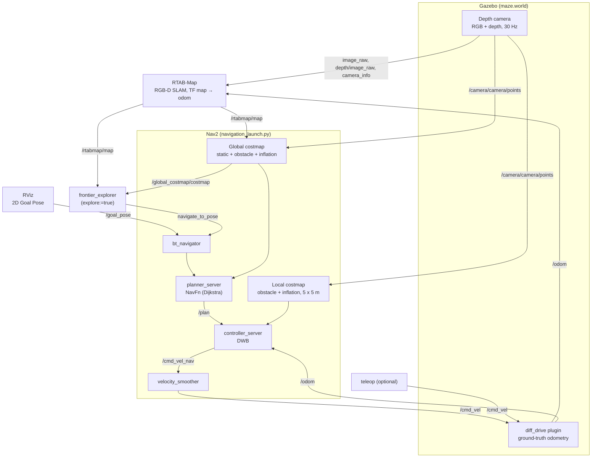

# depth package: Rover Mapping & Navigation

**Owner:** Soham · **Last updated:** 1 Nov 2026 · ROS 2 Humble · Gazebo Classic · RTAB-Map 0.23 · Nav2

## Contents

- [Start here: run the bot](#start-here-run-the-bot)
  - [Workspace setup (first time)](#workspace-setup-first-time)
  - [Build and terminal setup](#build-and-terminal-setup)
  - [Simulation: mapping + Nav2 + frontier exploration](#simulation-mapping--nav2--frontier-exploration)
  - [Real robot: Jetson + ESP + D435i](#real-robot-jetson--esp--d435i)
- [1. Overview](#1-overview)
  - [1.1 At a glance](#11-at-a-glance)
- [2. Running notes](#2-running-notes)
- [3. Package layout](#3-package-layout)
- [4. Robot model (urdf/rover.urdf)](#4-robot-model-urdfroverurdf)
  - [4.1 Key dimensions](#41-key-dimensions) · [4.2 Links and joints](#42-links-and-joints) · [4.3 Gazebo plugins and sensors](#43-gazebo-plugins-and-sensors) · [4.4 Contact and friction](#44-contact-and-friction) · [4.5 Quadruped alone](#45-quadruped-alone-urdfquadrupedurdf)
- [5. System architecture](#5-system-architecture)
  - [5.1 TF tree](#51-tf-tree) · [5.2 Data flow](#52-data-flow) · [5.3 Topics](#53-topics)
- [6. Mapping configuration (RTAB-Map)](#6-mapping-configuration-rtab-map)
  - [6.1 Key mapping values](#61-key-mapping-values) · [6.2 Launch arguments](#62-launch-arguments) · [6.3 Health check](#63-health-check)
- [7. Navigation configuration (Nav2)](#7-navigation-configuration-nav2)
  - [7.1 Key navigation values](#71-key-navigation-values) · [7.2 Servers](#72-servers) · [7.3 Obstacle sensing](#73-obstacle-sensing-point-cloud) · [7.4 DWB controller](#74-dwb-controller-followpath) · [7.5 Costmaps](#75-costmaps) · [7.6 Frontier exploration](#76-frontier-exploration)
- [8. Tuning reference](#8-tuning-reference)
  - [8.1 Verification commands](#81-verification-commands)
- [9. Real robot (Jetson, D435i, ESP servos)](#9-real-robot-jetson-d435i-esp-servos)
  - [9.1 Real-mode notes](#91-real-mode-notes)
  - [9.2 Stereo IR mode (lower latency)](#92-stereo-ir-mode-lower-latency)
  - [9.3 Real robot dimensions](#93-real-robot-dimensions)
  - [9.4 Real robot legs (ESP servo bridge)](#94-real-robot-legs-esp-servo-bridge)
- [10. Known issues and next steps](#10-known-issues-and-next-steps)
  - [10.1 Open issues](#101-open-issues) · [10.2 Troubleshooting](#102-troubleshooting) · [10.3 Next steps](#103-next-steps)

---

## Start here: run the bot

Every command to run the bot is collected here. The sections after this one explain what each part does.

### Workspace setup (first time)

This repository is only the `depth` package. It goes in the `src` folder of a colcon workspace; the commands in this README use `~/depth_mapping`:

```text
~/depth_mapping/           colcon workspace
├── src/
│   └── depth/             this repository
└── build/  install/  log/ created by colcon build
```

Needed first: ROS 2 Humble with Gazebo Classic (`gazebo_ros_pkgs`), and RTAB-Map 0.23 built from source in its own workspace, `~/rtabmap_ws` (see [rtabmap_ros](https://github.com/introlab/rtabmap_ros/tree/ros2)).

```bash
mkdir -p ~/depth_mapping/src
cd ~/depth_mapping/src
git clone https://github.com/Soham2135696/rtabmap-nav2-frontier-exploration.git depth   # the folder must be src/depth
cd ~/depth_mapping
source /opt/ros/humble/setup.bash
source ~/rtabmap_ws/install/setup.bash
sudo rosdep init                         # only if rosdep was never initialised
rosdep update
rosdep install --from-paths src --ignore-src -y --skip-keys "rtabmap_launch rtabmap_util"
```

`rosdep` installs the apt dependencies listed in `package.xml` (Nav2, ros2_control, RealSense driver, IMU filter, Python packages). RTAB-Map is skipped because it comes from `~/rtabmap_ws`. Then build as below.

### Build and terminal setup

Build once, and again after any change in `src/depth`: launch files are read from `install/`, not from `src/`.

```bash
cd ~/depth_mapping
source /opt/ros/humble/setup.bash
source ~/rtabmap_ws/install/setup.bash
colcon build --packages-select depth
```

Start every terminal below with:

```bash
cd ~/depth_mapping
source ~/rtabmap_ws/install/setup.bash
source install/setup.bash
```

### Simulation: mapping + Nav2 + frontier exploration

Start the terminals in this order:

| Terminal | Command | Notes |
| --- | --- | --- |
| **1. Gazebo + robot** | `ros2 launch depth 2_gazebo.launch.py` | Gazebo, maze, rover, RViz, ros2_control controllers |
| **2. RTAB-Map** | `ros2 launch depth rtabmap.launch.py` | Start after the rover has spawned |
| **3. Nav2 + exploration** | `ros2 launch depth nav2.launch.py` | Exploration starts by itself (`explore:=auto`). For 2D Goal Pose instead: add `explore:=false` |
| **4. Teleop (optional)** | `ros2 run teleop_twist_keyboard teleop_twist_keyboard --ros-args -p speed:=0.15 -p turn:=0.3` | Only with `explore:=false`; keep idle while Nav2 drives |

- Exploration stops when no frontier is left; watch the log for `Exploration complete` ([section 7.6](#76-frontier-exploration)).
- Add `gui:=false` to terminal 1 for Gazebo without windows (no RViz).
- RTAB-Map deletes `~/.ros/rtabmap.db` on every start, so each run maps from scratch.

**Quadruped on its own (no rover):** `ros2 launch depth 2_gazebo.launch.py robot:=quadruped` spawns `urdf/quadruped.urdf` standing on the floor, facing +x. Move the legs with `ros2 run depth walk_gait` in a second terminal: it rises to the stand pose, `f` walks, `s` stands. RTAB-Map and Nav2 are not set up for it ([section 4.5](#45-quadruped-alone-urdfquadrupedurdf)).

### Real robot: Jetson + ESP + D435i

The real robot runs without Gazebo. A **Jetson Orin Nano Super** on the robot connects over USB to the ESP that drives the 12 leg servos and to the D435i depth camera. The laptop connects to the Jetson over SSH and shows RViz. Everything except RViz runs on the Jetson: the camera images are too heavy to send over Wi-Fi, and the gait keeps walking if the Wi-Fi drops.

```text
Jetson:  walk_gait real:=true --/joint_states--> esp --USB serial--> ESP --> 12 servos
                                            \--> robot_state_publisher --> leg TF
         D435i --> real_sensors --> RTAB-Map --> Nav2
Laptop:  SSH terminals + RViz (same ROS_DOMAIN_ID, same network)
```

**One-time setup on the Jetson**

1. Ubuntu 22.04 (JetPack 6) with ROS 2 Humble. Set up the workspace exactly as in [Workspace setup](#workspace-setup-first-time): this repository in `~/depth_mapping/src/depth`, RTAB-Map 0.23 in `~/rtabmap_ws`, `rosdep install`, then [build](#build-and-terminal-setup). Gazebo is not needed on the Jetson.
2. Serial port access for `esp`, then log out and in again:
   ```bash
   sudo usermod -aG dialout $USER
   ```
3. Check the ESP's port with `ls /dev/ttyUSB* /dev/ttyACM*` (default `/dev/ttyUSB0`).
4. Use the same `ROS_DOMAIN_ID` on the Jetson and the laptop (the default, 0, is fine), on the same network. Do not run Gazebo on that domain at the same time: its `/joint_states`, camera topics and TF would mix with the real robot's.

The laptop needs this package built too (as in [Build](#build-and-terminal-setup)): RViz loads the robot meshes from its own install.

**Every terminal**, Jetson and laptop:

```bash
cd ~/depth_mapping
source ~/rtabmap_ws/install/setup.bash
source install/setup.bash
```

**Run, in this order** (Jetson terminals are SSH sessions from the laptop: `ssh <user>@<jetson-ip>`):

| # | Where | Command | Notes |
| --- | --- | --- | --- |
| **1. Robot + ESP + camera** | Jetson | `ros2 launch depth real_robot.launch.py camera:=true` | robot_state_publisher (`quadruped.urdf`), `esp`, and the D435i (`real_sensors.launch.py`). Legs only: leave out `camera:=true`. ESP on another port: add `port:=/dev/ttyACM0`. Prints `Serial connected on …` |
| **2. Gait** | Jetson | `ros2 run depth walk_gait --ros-args -p real:=true` | **Hold the robot.** The servos go to 90° (zero pose), then stand up in about 1.4 s. Type `f` to walk, `s` to stand |
| **3. RViz** | Laptop | `rviz2 -d /opt/ros/humble/share/nav2_bringup/rviz/nav2_default_view.rviz` | Fixed Frame `base_link` (legs only) or `map` (with RTAB-Map). Add **RobotModel** (Description Topic `/robot_description`) and **TF**; Map display topic `/rtabmap/map` |
| **4. RTAB-Map** | Jetson | `ros2 launch depth rtabmap.launch.py mode:=real rtabmap_viz:=false` | After the camera stream is up. `rtabmap_viz:=false` because SSH has no display |
| **5. Nav2** | Jetson | `ros2 launch depth nav2.launch.py mode:=real` | After `/rtabmap/map` appears. Plans and builds costmaps, but cannot move the legs yet: walk_gait does not read `/cmd_vel` ([section 10.1](#101-open-issues)) |

- **Camera options** (`camera_mode:=stereo`, `cam_*`, `base_height`, …) go straight on step 1, next to `camera:=true`; see [Launch arguments](#launch-arguments-real-robot). Stereo mode needs `camera_mode:=stereo` on step 4 too ([section 9.2](#92-stereo-ir-mode-lower-latency)).
- **Checks:** `ros2 topic hz /joint_states` shows about 20 Hz; the step 1 terminal prints a `Sent: …` line for every message; `ros2 topic hz /camera/camera/color/image_raw` (RGB-D) or `/camera/camera/infra1/image_rect_raw` (stereo) shows the camera rate.
- **Stopping:** type `s`, support the robot, then Ctrl+C walk_gait. The servos hold their last angle until step 1 stops.

#### Connecting to the Jetson

Once, with a screen on the Jetson or from the router's device list, find its IP address:

```bash
hostname -I                          # on the Jetson: first address, e.g. 192.168.1.42
```

From the laptop:

| What | Command | Notes |
| --- | --- | --- |
| **Check the Jetson is reachable** | `ping <jetson-ip>` | Laptop and Jetson on the same Wi-Fi |
| **Log in without a password** (once) | `ssh-copy-id <user>@<jetson-ip>` | Then `ssh` no longer asks for the password |
| **Open a Jetson terminal** | `ssh <user>@<jetson-ip>` | One per Jetson step, or one with tmux (next row) |
| **Keep the robot running if Wi-Fi drops** | On the Jetson: `tmux new -s robot`. New window `Ctrl+b c`, next window `Ctrl+b n`, detach `Ctrl+b d`. After reconnecting: `tmux attach -t robot` | Without tmux, a dropped SSH session stops every command started in it, walk_gait included. Install with `sudo apt install tmux` |
| **Same ROS domain on both** | `echo $ROS_DOMAIN_ID` on both (empty = 0). To set it: `echo 'export ROS_DOMAIN_ID=0' >> ~/.bashrc`, then open a new terminal | Must match, or the laptop sees no topics |
| **Check ROS traffic both ways** | Jetson: `ros2 run demo_nodes_cpp talker`; laptop: `ros2 run demo_nodes_cpp listener` | The listener prints `I heard: …`. If not: firewall (`sudo ufw disable` on both to test) or a network that blocks multicast |
| **Check the clocks match** | `date` on both; `timedatectl` shows `System clock synchronized: yes` | A few seconds apart and RViz drops the Jetson's TF (`extrapolation into the future`) |
| **Check the hardware** (Jetson) | `ls /dev/ttyUSB* /dev/ttyACM*` (ESP port); `rs-enumerate-devices -s` (D435i) | Pass the ESP port as `port:=…` in step 1 |
| **Update the code** (Jetson) | `cd ~/depth_mapping/src/depth && git pull && cd ~/depth_mapping && colcon build --packages-select depth` | Then re-source (`source install/setup.bash`) in every terminal |
| **Copy a map to the laptop** | `scp <user>@<jetson-ip>:~/.ros/rtabmap_real.db .` | The real-mode RTAB-Map database; deleted on the next start unless `delete_db:=false` |

#### Launch arguments (real robot)

Pass them as `name:=value` after the launch file, e.g. `ros2 launch depth real_robot.launch.py camera:=true camera_mode:=stereo port:=/dev/ttyACM0`. Node parameters go after `--ros-args -p`.

**`real_robot.launch.py`** (step 1):

| Argument | Default | What it does |
| --- | --- | --- |
| `port` | `/dev/ttyUSB0` | ESP serial port for `esp` |
| `camera` | `false` | `true`: also start the D435i (`real_sensors.launch.py`) |
| `rviz` | `false` | `true`: also open RViz on this machine (not over SSH) |
| All `real_sensors.launch.py` arguments below | | Passed on to the camera when `camera:=true` |

**`real_sensors.launch.py`** (the camera; through step 1 with `camera:=true`, or on its own):

| Argument | Default | What it does |
| --- | --- | --- |
| `camera_mode` | `rgbd` | `rgbd`: colour + aligned depth. `stereo`: the two IR images, lower latency ([section 9.2](#92-stereo-ir-mode-lower-latency)). Use the same value on RTAB-Map |
| `emitter` | `0` | Stereo only: IR dot projector, `0` off (better odometry), `1` on (better depth on plain walls) |
| `infra_fps` | `30` | Stereo only: IR and depth frame rate (6, 15, 30, 60, 90) |
| `use_imu` | `true` (if `imu_filter_madgwick` is installed) | Camera IMU through the Madgwick filter on `/imu/data`. Use the same value on RTAB-Map |
| `cam_x`, `cam_y`, `cam_z` | `0.167`, `0.0`, `0.013` | Camera position from `base_link` (body centre), metres ([section 9.3](#93-real-robot-dimensions)) |
| `cam_roll`, `cam_pitch`, `cam_yaw` | `0.0` | Camera angle, radians; pitch positive = tilted down |
| `base_height` | `0.19` | `base_link` above the floor (stand pose) |

**`rtabmap.launch.py`** (step 4):

| Argument | Default | What it does |
| --- | --- | --- |
| `mode` | `sim` | `real` for the robot |
| `camera_mode` | `rgbd` | Same as the camera's `camera_mode` |
| `use_imu` | `true` | Same as the camera's `use_imu` |
| `rtabmap_viz` | `true` | `false` over SSH (no display) |
| `localization` | `false` | `true`: localize on the saved map instead of mapping |
| `delete_db` | `true` | `false`: keep the previous map and continue it |

**`nav2.launch.py`** (step 5):

| Argument | Default | What it does |
| --- | --- | --- |
| `mode` | `sim` | `real` for the robot |
| `explore` | `auto` | Frontier exploration: `auto` (off in real mode), `true`, `false` |

**Node parameters:**

| Node | Parameter | Default | What it does |
| --- | --- | --- | --- |
| `walk_gait` | `real` | `false` | `true`: real robot, publishes `/joint_states` (`ros2 run depth walk_gait --ros-args -p real:=true`) |
| `esp` | `port` | `/dev/ttyUSB0` | ESP serial port, when `esp` runs on its own (`ros2 run depth esp --ros-args -p port:=/dev/ttyACM0`) |

Examples:

```bash
# Stereo camera, ESP on /dev/ttyACM0
ros2 launch depth real_robot.launch.py camera:=true camera_mode:=stereo port:=/dev/ttyACM0
ros2 launch depth rtabmap.launch.py mode:=real camera_mode:=stereo rtabmap_viz:=false

# Camera tilted 10° down; continue the last map
ros2 launch depth real_robot.launch.py camera:=true cam_pitch:=0.1745
ros2 launch depth rtabmap.launch.py mode:=real rtabmap_viz:=false delete_db:=false
```

> **Real robot status**
> - **Tested:** the D435i with RTAB-Map mapping and the Nav2 costmaps, with the camera held in the hand (laptop only). The real servos following Gazebo's legs through `esp` (1 Nov 2026).
> - **Tested without hardware** (laptop, 2 Nov 2026): `real_robot.launch.py` with and without `camera:=true`, and `walk_gait real:=true` driving the leg TF to the stand pose.
> - **Not tested yet:** the Jetson setup, `walk_gait real:=true` moving the real servos, mapping with the camera mounted on the robot, Nav2 driving the robot, and frontier exploration (`explore:=true`).

---

## 1. Overview

`depth` is a ROS 2 Humble package that simulates a wheeled rover in Gazebo Classic, maps a maze with RTAB-Map using a depth camera, and navigates it autonomously with Nav2. By default a frontier exploration node drives the rover to the edges of the known map until the maze is mapped ([section 7.6](#76-frontier-exploration)); with exploration off, a 2D Goal Pose in RViz drives it through the maze without collisions; map quality is still being tuned (see [section 10](#10-known-issues-and-next-steps)). `robot:=quadruped` spawns the quadruped alone, without the rover, for leg tests ([section 4.5](#45-quadruped-alone-urdfquadrupedurdf)). The real robot runs without Gazebo on a Jetson Orin Nano Super: the gait drives the 12 servos through an ESP, and mapping and Nav2 run on a real Intel RealSense D435i depth camera ([section 9](#9-real-robot-jetson-d435i-esp-servos)); Nav2 and frontier exploration on the real robot are not tested yet.

### 1.1 At a glance

| Item | Details |
| --- | --- |
| **Robot** | Simulation: differential-drive base (2 drive wheels + 2 castors) and an IMU, carrying the quadruped body (4 legs, 12 position-controlled joints) with a depth camera in its front socket. `robot:=quadruped` spawns the quadruped alone ([section 4.5](#45-quadruped-alone-urdfquadrupedurdf)) |
| **World** | `worlds/maze.world`: 10 × 10 m maze, 1.2 m walls, corridors about 1.85 m wide |
| **Spawn pose** | (-4, -4), facing +x; z 0.15 (rover) or 0.18 (quadruped alone) |
| **Mapping** | RTAB-Map 0.23 (built from source in `~/rtabmap_ws`), RGB-D mode, loop closure disabled |
| **Odometry** | Gazebo ground truth from the diff_drive plugin (`odometry_source 1`) |
| **Navigation** | Nav2 `navigation_launch.py` (no map_server / AMCL), NavFn (Dijkstra) planner, DWB controller |
| **Exploration** | `frontier_explorer` node (started by `nav2.launch.py`): sends Nav2 goals to frontiers of `/rtabmap/map` until none is left |
| **Obstacle sensing** | Depth point cloud (`/camera/camera/points`) read directly by the costmap obstacle layers (60° forward view) |
| **Package** | `ament_python`; workspace `~/depth_mapping`, package `src/depth` |

---

## 2. Running notes

The commands are in [Start here](#start-here-run-the-bot) at the beginning of this README. Notes for running them:

- The rover starts exploring on its own once Nav2 and the map are up, and stops when no frontier is left ([section 7.6](#76-frontier-exploration)).
- To drive with **2D Goal Pose** in RViz instead, start Nav2 with `ros2 launch depth nav2.launch.py explore:=false`.
- In teleop, `q` / `z` raise / lower speed by 10%; the start values are not a hard cap.
- RTAB-Map deletes `~/.ros/rtabmap.db` on every start, so each run maps from scratch.
- Real-robot details are in [section 9](#9-real-robot-jetson-d435i-esp-servos).

---

## 3. Package layout

All launch, config, URDF, mesh and world files are installed to `install/depth/share/depth/` by `setup.py`.

| Path | Purpose |
| --- | --- |
| **Launch** | |
| `launch/2_gazebo.launch.py` | Gazebo + maze, robot_state_publisher, RViz, spawns the robot, starts the ros2_control controllers. `robot:=rover` (default) or `robot:=quadruped` (quadruped alone). Fills `DEPTH_SHARE_DIR` and `package://depth` in the URDF. `gui:=false` runs gzserver only |
| `launch/rtabmap.launch.py` | Includes `rtabmap_launch/rtabmap.launch.py` with topics, frames and RTAB-Map parameters; `mode:=sim` (default) or `mode:=real` |
| `launch/nav2.launch.py` | Includes Nav2 `navigation_launch.py` with `config/nav2_params.yaml` (sim) or `config/nav2_params_real.yaml` (`mode:=real`), and starts `frontier_explorer` (`explore:=auto`: on in sim, off in real) |
| `launch/real_sensors.launch.py` | Real robot: D435i driver, Madgwick IMU filter, static TFs, downsampled obstacle cloud |
| `launch/real_robot.launch.py` | Real robot, no Gazebo: robot_state_publisher (`quadruped.urdf`) and `esp`; `camera:=true` adds `real_sensors.launch.py` (its arguments pass through), `port:=` sets the ESP port, `rviz:=true` opens RViz ([section 9.4](#94-real-robot-legs-esp-servo-bridge)) |
| `launch/display.launch.py` | RViz-only model view (robot_state_publisher + RViz, no joint state source) |
| **Config** | |
| `config/nav2_params.yaml` | DWB controller, goal checker, global and local costmaps |
| `config/nav2_params_real.yaml` | Real-robot copy: no sim time, `/camera/obstacle_cloud`, D435i ranges, slower turns, looser TF tolerances |
| `config/realsense_emitter_off.yaml` | RealSense `config_file` that turns off the IR emitter (`real_sensors.launch.py camera_mode:=stereo emitter:=0`) |
| `config/controllers.yaml` | ros2_control at 100 Hz: `joint_state_broadcaster` + `joint_group_controller` (position, 12 leg joints, walk_gait's order). Used by both robots |
| **Model & world** | |
| `urdf/rover.urdf` | Default robot: wheeled base, IMU, diff_drive and friction, with the quadruped body, legs and depth camera mounted on top |
| `urdf/quadruped.urdf` | The quadruped alone (`robot:=quadruped`): the same body, legs and camera, with PID leg joints and foot contacts ([section 4.5](#45-quadruped-alone-urdfquadrupedurdf)) |
| `meshes/*.stl` | Quadruped body (`base_link.stl`) and legs (`servo_1–4`, `ccup_1–4`, `thigh_1–4`, `foot_1–4`), in millimetres (scaled 0.001) |
| `worlds/maze.world` | The maze used by `2_gazebo.launch.py` |
| **Nodes** | |
| `depth/frontier_explorer.py` | Frontier exploration node (`ros2 run depth frontier_explorer`); parameters have built-in defaults, see [section 7.6](#76-frontier-exploration) |
| `depth/walk_gait.py` | Leg gait (`ros2 run depth walk_gait`): holds the stand pose, `f` walks, `s` stands; 12 joint angles at 20 Hz, each joint moving at most 1 rad/s. Gazebo: on `/joint_group_controller/commands`; `real:=true`: on `/joint_states` ([section 4.5](#45-quadruped-alone-urdfquadrupedurdf)). Older versions are kept commented out at the top of the file |
| `depth/esp.py` | Serial bridge to the real servos (started by `real_robot.launch.py`, or `ros2 run depth esp`): `/joint_states` → 12 servo angles on the serial port (`port` parameter, default `/dev/ttyUSB0`) ([section 9.4](#94-real-robot-legs-esp-servo-bridge)). Older versions are kept commented out at the top of the file |
| `depth/cal_servo.py` | Old servo calibration test (`ros2 run depth cal_servo`). Still uses the old model's joint names (`CCUP1`, `THIGH1`, `FOOT1`, …), so it sends nothing with the current model |
| **Other** | |
| `depth/__init__.py` | Python package marker |
| `test/` | Standard ament copyright, flake8 and pep257 tests |
| Unused | `config/pointcloud_to_laserscan.yaml` (old point cloud → `/scan` conversion), `worlds/A1.world`, `worlds/model.sdf` |

---

## 4. Robot model (urdf/rover.urdf)

### 4.1 Key dimensions

| Property | Value |
| --- | --- |
| **Total mass** | 13.6 kg |
| **Centre of gravity** | 0.14 m above ground |
| **Forward direction** | +x of `base_link` |
| **Outline (top view)** | x -0.20 to +0.33 m (rear castor to front feet), y ±0.19 m (legs) |
| **base_link** | 0.2 × 0.2 × 0.1 m box, 2 kg, 0.10 m above ground |
| **Drive wheels** | radius 0.05 m, width 0.06 m, separation 0.30 m |
| **Quadruped body** | 0.3 m above `base_link`, turned -90° so its front faces +x (its CAD front is +y) |
| **Camera** | In the body's front socket: 0.165 m forward, 0.337 m above `base_link` (0.44 m above ground), facing +x |
| **Legs** | Lowest point 0.26 m above ground at zero pose (do not touch the floor) |

### 4.2 Links and joints

| Joint | Type | Parent → child | Origin xyz / rpy | Notes |
| --- | --- | --- | --- | --- |
| `base_footprint_joint` | fixed | base_footprint → base_link | 0 0 0 / 0 0 0 | base_link sits 0.10 m above ground |
| `wheel_front_left_joint` | continuous | base_link → wheel_front_left | 0 0.15 -0.05 / -1.5708 0 0 | 2 kg; axis +y |
| `wheel_front_right_joint` | continuous | base_link → wheel_front_right | 0 -0.15 -0.05 / -1.5708 0 0 | Same as left |
| `castor_wheel_joint` | fixed | base_link → back_castor_wheel | -0.15 0 -0.05 / 1.57 0 0 | Sphere, visual r 0.05, collision r 0.048, 2 kg; at the rear |
| `castor_wheel_joint_2` | fixed | base_link → front_castor_wheel | 0.15 0 -0.05 / 1.57 0 0 | Same, at the front |
| `imu_joint` | fixed | base_link → imu_link | 0 0 0.2 / 0 0 0 | 0.1 kg |
| `botbase` | fixed | base_link → quad_body | -0.068 -0.068 0.3 / 0 0 -1.5708 | Quadruped body (`base_link.stl`), 1.10 kg. Its CAD origin is a body corner and its front is +y, hence the offset and the -90° turn |
| `camera_joint` | fixed | quad_body → camera | -0.0679 0.2327 0.0374 / 0 0 1.5708 | In the body's front socket (95.5 × 32 mm opening), front face flush with the plate; 0.025 × 0.09 × 0.025 m, 0.072 kg |
| `camera_optical_joint` | fixed | camera → camera_link_optical | 0 0 0 / -1.5708 0 -1.5708 | Optical convention: z forward, x right, y down |
| `base_link_Revolute_1`–`_4` | continuous | quad_body → servo_1–4 | hip | Each servo is fixed to its hip cup (`servo_N_Rigid_*` → `ccup_N`) |
| `ccup_N_Revolute_*` | continuous | ccup_N → thigh_N | thigh | |
| `thigh_N_Revolute_*` | continuous | thigh_N → foot_N | foot | No joint limits or damping on any leg joint |

The 12 leg joints are position-controlled through `/joint_group_controller/commands`, in the order of `config/controllers.yaml` (walk_gait's order):

| Leg | Hip | Thigh | Foot |
| --- | --- | --- | --- |
| 1, back right | `base_link_Revolute_1` | `ccup_3_Revolute_31` | `thigh_3_Revolute_32` |
| 2, back left | `base_link_Revolute_3` | `ccup_2_Revolute_28` | `thigh_2_Revolute_29` |
| 3, front left | `base_link_Revolute_4` | `ccup_1_Revolute_25` | `thigh_1_Revolute_26` |
| 4, front right | `base_link_Revolute_2` | `ccup_4_Revolute_34` | `thigh_4_Revolute_35` |

On the rover the legs never touch the floor, and nothing in the mapping and navigation setup commands them; the rover drives on its wheels.

### 4.3 Gazebo plugins and sensors

| Plugin | Key settings | Publishes |
| --- | --- | --- |
| **gazebo_ros2_control** | Parameters from `DEPTH_SHARE_DIR/config/controllers.yaml` (path filled by the launch file) | `/controller_manager` services; `/joint_states` via joint_state_broadcaster |
| **diff_drive** | wheel_separation 0.30, wheel_diameter 0.10, max_wheel_torque 20, max_wheel_acceleration 2.0, odometry_source 1 (ground truth), odometry_frame `odom`, robot_base_frame `base_footprint` | `/odom`, TF odom → base_footprint, wheel TFs; subscribes `/cmd_vel` |
| **Depth camera** | In the quadruped's front socket. 30 Hz, 640 × 480, HFOV 1.047 rad (60°), clip 0.05–10 m, namespace `/camera`, frame `camera_link_optical` | `/camera/camera/image_raw`, `…/depth/image_raw`, `…/points`, camera_info |
| **IMU** | 100 Hz, gaussian noise (gyro 0.0002, accel 0.017), frame `imu_link` | `/imu/data` |

### 4.4 Contact and friction

| Part | Setting | Reason |
| --- | --- | --- |
| **Castors** | `mu1 = mu2 = 0` | Slide instead of dragging |
| **Drive wheels** | `mu1 = mu2 = 1.0`, `kp 1e6`, `kd 100`, `minDepth 0.001` | Firm grip, no sinking |
| **Castor collision** | r 0.048 (2 mm smaller than visual) | Drive wheels carry the weight and keep their grip |

> [!WARNING]
> **URDF rules that break things**
> - Friction must go in `<gazebo reference>` blocks; URDF `<contact_coefficients>` tags are ignored by Gazebo.
> - Never put a colon followed by a space anywhere in the URDF, comments included. gazebo_ros2_control passes the URDF as a YAML parameter and the plugins silently fail to load: no controllers start, and the legs hang straight down.

### 4.5 Quadruped alone (urdf/quadruped.urdf)

`ros2 launch depth 2_gazebo.launch.py robot:=quadruped` spawns the quadruped without the rover: the same body, legs, camera and joint names as `rover.urdf`, and the same `config/controllers.yaml`. It is for testing the legs; RTAB-Map, Nav2 and exploration are not set up for it.

| Item | Value |
| --- | --- |
| **Model** | `urdf/quadruped.urdf`, robot name `quadruped`, 3.48 kg |
| **Root frame** | `base_link` = body centre (middle of the four hips), x forward, like the rover. The CAD body is `quad_body` under it (`botbase`: yaw -90°, as in rover.urdf) |
| **Spawn** | (-4, -4, 0.18), facing world +x. The feet are 0.165 m below `base_link` at the zero pose |
| **Standing height** | `base_link` about 0.163 m above the floor at the zero pose, 0.20 m in walk_gait's stand pose |
| **Camera** | Same sensor and topics as the rover; (0.167, 0, 0.013) from `base_link` |
| **Not included** | Wheels, castors, diff_drive, IMU; so no `/odom` and no TF odom → base_link |

Physics settings, only in `quadruped.urdf` (the rover's legs never touch the floor, so it does not need them):

| Setting | Value | Why |
| --- | --- | --- |
| **Leg command interface** | `position_pid`, `pos_kp` 60, `pos_kd` 1.5 | Gazebo turns each position command into joint torque, torque = 60 × (target − angle) − 1.5 × speed. Plain `position` teleports the joints every step, and the robot exploded once its feet touched the floor. The controller still uses the position interface, so the topic and `controllers.yaml` are unchanged |
| **`hold_joints`** | false (gazebo_ros2_control plugin) | Otherwise the joints are locked at zero speed until the controller starts, which threw the robot around when it landed |
| **Feet** (`foot_1`–`foot_4`) | `mu1 = mu2 = 1.0`, `kp 1e5`, `kd 100`, `minDepth 0.001`, `maxVel 0` | Without them the feet jitter on the floor and the robot slides about 5 mm/s while standing |

**walk_gait** (`depth/walk_gait.py`) publishes the 12 joint angles at 20 Hz, in the order of the table in [section 4.2](#42-links-and-joints). It is the gait from the Gazebo Harmonic version of this robot, with the Classic joint names; the two models have the same joints. walk_gait works with both robots; on the rover the legs only swing.

| Part | How it works |
| --- | --- |
| **Commands** | Holds the stand pose (`STAND`, thigh ±1.40 rad, foot −0.46 rad). Type `f` to walk and `s` to stand again |
| **Inverse kinematics** | Closed-form 3-joint leg solution (`IK_left`, `IK_right`) with link lengths `L1` 0.050, `L2` 0.135, `L3` 0.1575 m |
| **Foot path** | Four points per leg, `step_time` 0.5 s each (2 s cycle): centre → back (`step_length` 0.010 m) → lifted (`step_height` 0.010 m) → front → centre |
| **Leg timing** | Diagonal pairs half a cycle apart (`phase_offsets` `[0, 2, 0, 2]`): back-right with front-left, back-left with front-right |
| **Output** | Gazebo (default): `/joint_group_controller/commands`. `real:=true` (real robot, no Gazebo): `/joint_states`, read by `esp` and robot_state_publisher ([section 9.4](#94-real-robot-legs-esp-servo-bridge)) |
| **Speed limit** | Each joint moves at most `max_joint_speed` (1.0 rad/s) towards its target, starting from the angles of the first `/joint_states` message (Gazebo) or from the zero pose (`real:=true`, as the servos do not report their angles). The robot rises to the stand pose in about 1.4 s, and `f` / `s` blend in over about 0.3 s instead of jumping. Jumping straight to the stand pose made the legs kick and flipped the robot |

In Gazebo mode, walk_gait waits for `/joint_states` before it publishes anything, so Gazebo has to be running.

**Test status:** the quadruped spawns level at the spawn point and stands without drifting (about 2° roll). With `esp` running, the real servos follow the simulated legs through stand-up and walking (tested 1 Nov 2026). How far and how straight the current gait walks in Gazebo has not been measured yet.

---

## 5. System architecture

### 5.1 TF tree

Only two transforms move with the robot's position: **map → odom** from RTAB-Map and **odom → base_footprint** from Gazebo's diff_drive. Everything below `base_link` comes from robot_state_publisher, which also turns `/joint_states` into the 12 leg transforms.

```text
map
└── odom                                  map → odom: RTAB-Map correction (dynamic, should stay near 0)
    └── base_footprint                    odom → base_footprint: Gazebo diff_drive (dynamic, ground truth)
        └── base_link                     robot_state_publisher (static, identity); Nav2 robot frame
            ├── wheel_front_left          diff_drive wheel TF (y +0.15, z -0.05, spins)
            ├── wheel_front_right         diff_drive wheel TF (y -0.15, z -0.05, spins)
            ├── back_castor_wheel         static (x -0.15)
            ├── front_castor_wheel        static (x +0.15)
            ├── imu_link                  static (z 0.2; frame of /imu/data)
            └── quad_body                 static (botbase: z 0.3, yaw -90°; quadruped body)
                ├── camera                static (front socket; 0.165 m forward, 0.337 m above base_link)
                │   └── camera_link_optical   static (z forward; images and /camera/camera/points)
                ├── servo_3 ─ ccup_3 → thigh_3 → foot_3   leg 1, back right
                ├── servo_2 ─ ccup_2 → thigh_2 → foot_2   leg 2, back left
                ├── servo_1 ─ ccup_1 → thigh_1 → foot_1   leg 3, front left
                └── servo_4 ─ ccup_4 → thigh_4 → foot_4   leg 4, front right
```

In the leg branches, `quad_body → servo_N` is the hip joint, `─` is a fixed joint and `→` is a moving joint (thigh, foot); robot_state_publisher computes them from `/joint_states`. With `robot:=quadruped` the tree is only the quadruped: `base_link` (the body) with its legs and camera, and no map, odom or base_footprint.

- Wheel transforms come from diff_drive (`publish_wheel_tf`) because the wheel joints are not in ros2_control.
- Gazebo merges fixed-joint links into one body, but TF still publishes every frame.
- Check the live tree with `ros2 run tf2_tools view_frames`.

### 5.2 Data flow

The depth camera's output splits two ways: images go to RTAB-Map to build the map, and the point cloud goes straight into the Nav2 costmaps for obstacle avoidance. Nav2 plans on both and sends `/cmd_vel` back to the diff_drive plugin, closing the loop. Goals come from frontier_explorer (default) or from an RViz 2D Goal Pose (`explore:=false`).



Not drawn: every node also reads `/tf`; frontier_explorer also calls `compute_path_to_pose` (planner_server) and `spin` (behavior_server).

### 5.3 Topics

All nodes run on simulation time (`/clock` from Gazebo).

| Topic | Type | Publisher | Subscribers |
| --- | --- | --- | --- |
| **Sensors** | | | |
| `/camera/camera/image_raw` | Image | Depth camera | RTAB-Map |
| `/camera/camera/depth/image_raw` | Image (32FC1, m) | Depth camera | RTAB-Map |
| `/camera/camera/camera_info` | CameraInfo | Depth camera | RTAB-Map |
| `/camera/camera/points` | PointCloud2 | Depth camera | Costmap obstacle layers, RViz |
| `/imu/data` | Imu | IMU plugin | Not used yet |
| `/odom` | Odometry | diff_drive (ground truth) | RTAB-Map, Nav2 controller, velocity smoother |
| **Robot state** | | | |
| `/joint_states` | JointState | joint_state_broadcaster (Gazebo); walk_gait `real:=true` (real robot) | robot_state_publisher; walk_gait (Gazebo, first message only); esp (real servos) |
| `/joint_group_controller/commands` | Float64MultiArray | walk_gait (optional) | joint_group_controller (leg joint positions) |
| `/robot_description` | String | robot_state_publisher | spawn_entity, RViz |
| `/tf`, `/tf_static` | TFMessage | robot_state_publisher, diff_drive, RTAB-Map | All nodes |
| **Mapping** | | | |
| `/rtabmap/map` | OccupancyGrid | RTAB-Map | Global costmap static layer, frontier_explorer, RViz |
| `/rtabmap/mapGraph`, `/info`, `/mapData` | rtabmap_msgs | RTAB-Map | rtabmap_viz, debugging |
| **Navigation** | | | |
| `/goal_pose` | PoseStamped | RViz 2D Goal Pose | bt_navigator |
| `navigate_to_pose`, `compute_path_to_pose`, `spin` | Nav2 actions | bt_navigator, planner_server, behavior_server | frontier_explorer (client) |
| `/explore/frontiers` | MarkerArray | frontier_explorer | RViz (add it by topic) |
| `/plan` | Path | planner_server | controller_server, RViz |
| `/global_costmap/costmap`, `/local_costmap/costmap` | OccupancyGrid | Nav2 costmaps | RViz; frontier_explorer reads the global one |
| `/cmd_vel_nav` | Twist | controller_server (DWB) | velocity_smoother |
| `/cmd_vel` | Twist | velocity_smoother or teleop | diff_drive |

> [!NOTE]
> **One driver at a time.** Teleop and Nav2 both publish on `/cmd_vel`. Any teleop keypress fights Nav2's commands, including the goals frontier exploration sends.

---

## 6. Mapping configuration (RTAB-Map)

RTAB-Map builds the 2D occupancy map from the RGB-D camera and publishes **map → odom**. Because odometry is Gazebo ground truth, the configuration tells RTAB-Map to trust it and stops camera matching from changing it. All values below are set in `launch/rtabmap.launch.py`.

### 6.1 Key mapping values

| Setting | Value | Effect |
| --- | --- | --- |
| `Rtabmap/DetectionRate` | 2 Hz | Map nodes added twice as often as the default (1 Hz); no gaps while moving |
| `RGBD/LinearUpdate` | 0.05 m | New node after 5 cm of travel |
| `RGBD/AngularUpdate` | 0.05 rad | New node after ~3° of rotation |
| `Grid/Sensor` | 1 (depth) | Occupancy grid built from the depth camera |
| `Grid/RayTracing` | true | Free space cleared along each depth ray |
| `Grid/3D` | false | 2D occupancy grid for Nav2 |
| `Reg/Force3DoF` | true | Solve only x, y, yaw: map cannot tilt or lift |
| `RGBD/NeighborLinkRefining` | false | Keeps the perfect odometry between consecutive nodes |
| `RGBD/ProximityBySpace` | false | No proximity links (caused 22–44° rotation errors on plain walls) |
| `Kp/MaxFeatures` | -1 | Loop closure disabled: identical corridors gave false closures ~2.85 m off |
| `--delete_db_on_start` | flag | Fresh map each launch |

> [!IMPORTANT]
> **Parameters must go inside `args`.** `rtabmap_launch` silently ignores launch arguments it does not declare. Every RTAB-Map parameter (e.g. `--Grid/Sensor 1`) must be inside the `args` string, not passed as its own launch argument. In RTAB-Map 0.23, `Grid/Sensor` replaces the old `Grid/FromDepth`.

### 6.2 Launch arguments

| Argument | Value |
| --- | --- |
| `rgb_topic` | `/camera/camera/image_raw` |
| `depth_topic` | `/camera/camera/depth/image_raw` |
| `camera_info_topic` | `/camera/camera/camera_info` |
| `odom_topic` | `/odom` (`visual_odometry` false) |
| `frame_id` / `odom_frame_id` / `map_frame_id` | `base_footprint` / `odom` / `map` |
| `publish_tf_map` | true |
| `approx_sync` / `approx_sync_max_interval` / `queue_size` | true / 0.1 s / 30 |
| `depth` / `subscribe_rgb` | true / true (RGB-D mode) |
| `use_sim_time` | true |
| `rtabmap_viz` / `rviz` | true / false (uses the RViz from terminal 1) |

### 6.3 Health check

With ground-truth odometry, map → odom should stay close to zero. A growing offset means wrong camera matches are bending the map (seen as doubled, rotated walls):

```bash
ros2 run tf2_ros tf2_echo map odom
```

---

## 7. Navigation configuration (Nav2)

Nav2 runs from `navigation_launch.py` without map_server or AMCL: RTAB-Map supplies both the map (`/rtabmap/map`) and localisation (map → odom). A goal flows bt_navigator → planner (NavFn) → controller (DWB) → velocity_smoother → `/cmd_vel`. Parameters are in `config/nav2_params.yaml`.

### 7.1 Key navigation values

| Setting | Value | Where / why |
| --- | --- | --- |
| **Motion limits** | | |
| `max_vel_x` / `max_speed_xy` | 0.15 m/s | DWB; slow enough for the camera to map as it drives |
| `max_vel_theta` | 0.5 rad/s | DWB in-place turn limit |
| `acc_lim_x` / `acc_lim_theta` | 1.0 / 1.5 | DWB acceleration limits |
| `decel_lim_x` / `decel_lim_theta` | -1.5 / -2.0 | DWB deceleration limits |
| velocity_smoother `max_velocity` | 0.15 m/s, 0.5 rad/s | Same as DWB, so nothing upstream can go faster |
| behavior_server `max_rotational_vel` / `rotational_acc_lim` | 0.5 rad/s / 1.5 | Spins (recoveries, exploration look-around) bypass DWB and the smoother; capped to the DWB values |
| **Goal** | | |
| `xy_goal_tolerance` | 0.25 m | SimpleGoalChecker (stateful) |
| `yaw_goal_tolerance` | 0.25 rad | ~14° |
| **Robot shape & clearance** | | |
| `footprint` | `[[0.34, 0.19], [0.34, -0.19], [-0.21, -0.19], [-0.21, 0.19]]` | rover.urdf outline: x -0.20 (rear castor) to +0.33 m (front feet), y ±0.185 m. Real robot (quadruped alone, `nav2_params_real.yaml`): `[[0.34, 0.19], [0.34, -0.19], [-0.28, -0.19], [-0.28, 0.19]]` |
| `footprint_padding` | 0.02 m | Both costmaps |
| `inflation_radius` | 0.55 m | > footprint outer radius (~0.42 m with padding); still leaves a lane in 1.85 m corridors |
| `cost_scaling_factor` | 2.0 | Gentle cost fall-off keeps paths near corridor centres |
| **Sensing** | | |
| `obstacle_max_range` / `raytrace_max_range` | 3.0 / 4.0 m | Mark up to 3 m, clear up to 4 m |
| `min_obstacle_height` / `max_obstacle_height` | 0.1 / 0.7 m | In the costmap's global frame (`map` / `odom`); drops floor points, keeps the 1.2 m walls |
| **Rates** | | |
| `controller_frequency` | 10 Hz | controller_server |
| Global / local costmap update | 2 Hz / 5 Hz | Publish at the same rates |

### 7.2 Servers

| Node | Role | Configuration |
| --- | --- | --- |
| `bt_navigator` | Runs navigate-to-pose BT for each `/goal_pose` | Nav2 defaults |
| `planner_server` | Global path on the global costmap | NavFn (`GridBased`), `use_astar` false (Dijkstra), `allow_unknown` true (frontier goals sit next to unknown space) |
| `controller_server` | Follows the path at 10 Hz → `/cmd_vel_nav` | `FollowPath` = `DWBLocalPlanner` + `SimpleGoalChecker`; progress checker 0.5 m in **20 s** (Nav2's 10 s aborted goals behind the rover: a 180° turn alone takes ~8 s and turning is not progress) |
| `velocity_smoother` | Smooths `/cmd_vel_nav` → `/cmd_vel` | Capped at the DWB limits: 0.15 m/s, 0.5 rad/s |
| `behavior_server` | Recovery: spin, back up, wait; also frontier_explorer's 360° spins | Spin capped at the DWB limits (`max_rotational_vel` 0.5 rad/s, `rotational_acc_lim` 1.5; Nav2 defaults 1.0 / 3.2), because spins publish `/cmd_vel` directly and bypass DWB and the smoother. `transform_tolerance` 0.5 s (with 0.1 s, Gazebo TF ~60 ms late made every spin abort with "Collision Ahead") |
| `waypoint_follower` | Multi-goal following | Nav2 defaults |

### 7.3 Obstacle sensing (point cloud)

Both costmap obstacle layers subscribe to `/camera/camera/points` directly as a `PointCloud2` observation source named `depth_cloud`; there is no pointcloud_to_laserscan node and no `/scan` topic.

| Parameter | Value | Why |
| --- | --- | --- |
| `data_type` | `PointCloud2` | Raw depth camera cloud, no 2D conversion |
| `min_obstacle_height` | 0.1 m | Measured in the costmap's global frame (`map` / `odom`), not `base_link`. Keeps floor points out; a window reaching the floor gives a ring of fake obstacles |
| `max_obstacle_height` | 0.7 m | Keeps wall points (walls are 1.2 m) |
| `obstacle_min_range` / `obstacle_max_range` | 0.1 / 3.0 m | Mark up to 3 m |
| `raytrace_min_range` / `raytrace_max_range` | 0.1 / 4.0 m | Clear up to 4 m |
| `marking` / `clearing` | true / true | Clearing only happens along rays that hit a point; bearings with no return are not cleared |

### 7.4 DWB controller (FollowPath)

| Group | Parameters |
| --- | --- |
| **Velocity** | `min_vel_x` 0.0, `max_vel_x` 0.15, `min_speed_xy` 0.0, `max_speed_xy` 0.15, `max_vel_theta` 0.5, `min_speed_theta` 0.0 |
| **Acceleration** | `acc_lim_x` 1.0, `acc_lim_y` 0.0, `acc_lim_theta` 1.5 |
| **Deceleration** | `decel_lim_x` -1.5, `decel_lim_y` 0.0, `decel_lim_theta` -2.0 |
| **Sampling** | `vx_samples` 20, `vy_samples` 1, `vtheta_samples` 20, `sim_time` 1.7 s |
| **Stopping** | `xy_goal_tolerance` 0.25, `trans_stopped_velocity` 0.1, `stateful` true |
| **Evaluation** | `short_circuit_trajectory_evaluation` true |
| **Critic scales** | PathAlign 32, PathDist 32, RotateToGoal 32, GoalAlign 24, GoalDist 24, BaseObstacle 2.0, Oscillation (default) |

### 7.5 Costmaps

| Setting | Global costmap | Local costmap |
| --- | --- | --- |
| **Frame** | `map`, static size | `odom`, rolling 5 × 5 m |
| **robot_base_frame** | `base_link` | `base_link` |
| **Resolution** | 0.05 m | 0.05 m |
| **Update / publish rate** | 2 / 2 Hz | 5 / 5 Hz |
| **Layers** | static (`/rtabmap/map`, `subscribe_to_updates`) → obstacle (`/camera/camera/points`) → inflation | obstacle (`/camera/camera/points`) → inflation |
| **Obstacle ranges** | mark 3.0, clear 4.0, min 0.1 m | mark 3.0, clear 4.0, min 0.1 m |
| **Obstacle height window** | 0.1 to 0.7 m (in `map`) | 0.1 to 0.7 m (in `odom`) |
| **tf_filter_tolerance** | 0.5 s | 0.5 s (+ `transform_tolerance` 0.5 s) |
| **Inflation** | radius 0.55, scaling 2.0 | radius 0.55, scaling 2.0 |
| **Footprint** | measured polygon + 0.02 padding | same |
| **Unknown space** | tracked | — |
| **Publishing** | full costmap every time (`always_send_full_costmap`), read by frontier_explorer | Nav2 default |

### 7.6 Frontier exploration

`depth/frontier_explorer.py` maps the maze without manual goals. A **frontier** is a free cell of `/rtabmap/map` next to unknown space; driving there and looking around turns unknown space into map. The node is started by `nav2.launch.py` (`explore:=auto`: on in sim, off in real, where it is not tested yet) and talks to Nav2 through `nav2_simple_commander`. It waits for Nav2 (`planner_server` active; there is no AMCL), the map, the global costmap and TF, so it can start with Nav2.

**One cycle (1 Hz):**

1. **Find frontier cells**: free cells (0) with an unknown (-1) cell among their 8 neighbours.
2. **Keep the reachable ones**: only frontier cells in the free area 4-connected to the robot. Depth rays leak a little past walls and mark free cells on the other side; this drops them.
3. **Group** neighbouring cells into clusters; drop clusters shorter than `min_frontier_size`.
4. **Goal per cluster**: the free cell nearest the cluster's middle that is at least `goal_offset` from unknown or occupied cells and costs at most `max_goal_cost` in the global costmap, facing the frontier.
5. **Choose**: plan a path to the nearest `max_candidates` goals; score = size − path length − 0.3 × turn (rad); send the best as a NavigateToPose goal.
6. **While driving**: cancel if the frontier gets mapped on the way, or if the robot moves less than 0.1 m in `progress_timeout`.
7. **On arrival**: spin 360° (the camera only sees 60°). If fewer than 10 % of the unknown cells within 1 m of the frontier became known, the camera cannot see it from there (for example behind a wall): blacklist it.
8. **Finish**: when no frontier is left for 3 cycles, log `Exploration complete` and exit. If frontiers are left but all blacklisted, first clear the Nav2-failure blacklist once and retry (a goal that failed from one spot often works from another); then log `Exploration stopped … the map may be incomplete`.

**Blacklists** (within 0.5 m of a frontier): *Nav2 failures* (no path, aborted, no progress) are retried once at the end; *not observable* (visit revealed nothing) are never retried.

| Parameter | Default | Meaning |
| --- | --- | --- |
| `map_topic` / `costmap_topic` | `/rtabmap/map` / `/global_costmap/costmap` | Frontiers come from the map; goal costs from the costmap |
| `global_frame` / `robot_frame` | `map` / `base_link` | |
| `min_frontier_size` | 0.3 m | Shorter clusters are noise (gaps in a wall) |
| `goal_offset` | 0.3 m | Minimum distance from the goal to unknown or occupied cells |
| `goal_search_radius` | 1.0 m | How far from the frontier to look for a goal cell |
| `max_goal_cost` | 60 | Highest global costmap value (0–100) at a goal; 99 = inscribed |
| `size_weight` / `distance_weight` / `turn_weight` | 1.0 / 1.0 / 0.3 | Score = size_weight × size − distance_weight × path − turn_weight × turn |
| `max_candidates` | 5 | Nearest clusters that get a planned path (one planner call each) |
| `planner_frequency` | 1.0 Hz | Frontier search and progress checks |
| `progress_timeout` / `progress_distance` | 30 s / 0.1 m | Cancel and blacklist when the robot stops making progress |
| `frontier_gone_radius` | 0.5 m | Cancel the goal once no frontier cell is left this close to it |
| `spin_on_arrival` / `spin_time_allowance` | true / 40 s | 360° spin at the start and after each goal |
| `visit_check_radius` / `min_visit_gain` | 1.0 m / 0.1 | "Visit revealed nothing" test |
| `blacklist_radius` / `blacklist_retries` | 0.5 m / 1 | Blacklist size; how often Nav2 failures are retried |
| `finish_checks` | 3 | Cycles without a frontier before finishing |

Change a value with `ros2 run depth frontier_explorer --ros-args -p use_sim_time:=true -p min_frontier_size:=0.5` (start Nav2 with `explore:=false` first), or edit the default in the node and rebuild.

**In RViz** add `/explore/frontiers` (MarkerArray): blue points = frontier cells, yellow spheres = candidate goals, green arrow = chosen goal, red discs = blacklisted areas.

**Log lines to expect:** `Next frontier: <size> m long, path <length> m, goal (x, y)`, `Frontier mapped on the way`, `Visit revealed almost nothing … blacklisting the frontier`, `No progress towards the frontier`, `Retrying N frontier(s)`, and finally `Exploration complete` or `Exploration stopped`.

**Speed:** the explorer never sends velocities itself. Driving goes through DWB and the velocity smoother (0.15 m/s, 0.5 rad/s), and the 360° spins through behavior_server, capped at the same 0.5 rad/s; a full spin takes about 16 s (`spin_time_allowance` 40 s).

**Test status (simulation):**

- Frontier detection, goal placement, the reachability filter and both blacklists were checked on synthetic maps.
- In Gazebo the rover explores on its own and recovers from failed goals. The best observed run had mapped **91 %** of the 10 × 10 m maze (an earlier run, before the Nav2 fixes, stopped at 78 %).
- **Not yet confirmed:** a complete run to `Exploration complete` with all current fixes, including the spin speed cap. The test runs before it were cut short.

---

## 8. Tuning reference

Where to look when you want to change behaviour. Rebuild after editing any file.

| If you want to… | Change | File |
| --- | --- | --- |
| Drive slower / faster under Nav2 (and while exploring) | `max_vel_x`, `max_speed_xy`, `max_vel_theta`; keep velocity_smoother `max_velocity` / `min_velocity` and behavior_server `max_rotational_vel` equal to them | `nav2_params.yaml` |
| Turn more gently while mapping | `max_vel_theta` (try 0.3) | `nav2_params.yaml` |
| Keep paths further from walls | `inflation_radius` ↑ or `cost_scaling_factor` ↓ | `nav2_params.yaml` |
| Fit through tighter gaps | `inflation_radius` ↓ (keep > 0.42 m) | `nav2_params.yaml` |
| Stop closer to the goal | `xy_goal_tolerance`, `yaw_goal_tolerance` | `nav2_params.yaml` |
| Ignore low clutter / the floor | `min_obstacle_height` | `nav2_params.yaml` |
| See obstacles further out | `obstacle_max_range` / `raytrace_max_range` | `nav2_params.yaml` |
| Fill gaps in the map | `Rtabmap/DetectionRate` ↑, `RGBD/LinearUpdate` ↓ | `rtabmap.launch.py` |
| Re-enable loop closure | Remove `--Kp/MaxFeatures -1` | `rtabmap.launch.py` |
| Keep an old map between runs | Remove `--delete_db_on_start` | `rtabmap.launch.py` |
| Lower real-robot mapping latency | `camera_mode:=stereo` on both launch files | `real_sensors.launch.py`, `rtabmap.launch.py` |
| Better obstacle depth in stereo mode | `emitter:=1` (costs odometry robustness) | `real_sensors.launch.py` |
| Drive with 2D Goal Pose instead of exploring | `explore:=false` | `nav2.launch.py` |
| Ignore small frontiers / wall gaps | `min_frontier_size` ↑ | `frontier_explorer.py` |
| Prefer close frontiers over big ones | `distance_weight` ↑ or `size_weight` ↓ | `frontier_explorer.py` |
| Explore faster (less looking around) | `spin_on_arrival` false | `frontier_explorer.py` |
| Give Nav2 longer before abandoning a goal | `progress_timeout` ↑ | `frontier_explorer.py` |
| Stiffer / softer quadruped legs (`robot:=quadruped`) | `pos_kp` ↑ / ↓ (too high brings back jitter), `pos_kd` for damping | `quadruped.urdf` |
| Faster / gentler leg motion | `max_joint_speed` | `walk_gait.py` |
| Longer / higher / slower steps | `step_length`, `step_height`, `step_time` | `walk_gait.py` |
| A real servo turns the wrong way | Its sign (`+` / `-`) in front of `math.degrees(...)` | `esp.py` ([section 9.4](#94-real-robot-legs-esp-servo-bridge)) |

### 8.1 Verification commands

```bash
ros2 param get /rtabmap Reg/Force3DoF          # confirm an RTAB-Map value is live
ros2 param get /controller_server FollowPath.max_vel_x
ros2 run tf2_ros tf2_echo map odom             # should stay near zero
ros2 run tf2_tools view_frames                 # dump the TF tree
ros2 topic hz /camera/camera/points           # check the point cloud is flowing
ros2 node list | grep frontier_explorer        # exploration running (exits when done)
ros2 param get /behavior_server transform_tolerance   # 0.5: spins must not abort
```

Real robot latency, to compare `camera_mode:=rgbd` and `camera_mode:=stereo`:

```bash
ros2 topic hz /camera/camera/color/image_raw                   # rgbd input rate
ros2 topic hz /camera/camera/aligned_depth_to_color/image_raw  # rgbd input rate
ros2 topic hz /camera/camera/infra1/image_rect_raw             # stereo input rate
ros2 topic hz /odom                                            # visual odometry output rate
ros2 topic delay /odom                                         # camera stamp -> odometry out
ros2 topic delay /rtabmap/map                                  # map update lag
```

---

## 9. Real robot (Jetson, D435i, ESP servos)

The real robot runs without Gazebo, on a Jetson Orin Nano Super. `real_robot.launch.py` starts the robot model and the ESP servo bridge ([section 9.4](#94-real-robot-legs-esp-servo-bridge)), and `real_sensors.launch.py` provides the camera, IMU and TF that Gazebo provides in simulation. The same RTAB-Map and Nav2 launch files take `mode:=real` (default `mode:=sim`, unchanged). The commands, and which machine runs each, are under [Start here → Real robot](#real-robot-jetson--esp--d435i).

**Tested:** the real depth camera, held in the hand, with RTAB-Map building the map and the Nav2 costmaps building from real depth data. Nav2 runs in real mode with its own parameters (`config/nav2_params_real.yaml`). The real servos following Gazebo's legs through `esp`.

**Not tested yet:** the Jetson setup, `walk_gait real:=true` on the real servos, mapping with the camera mounted on the robot, Nav2 driving the robot to a goal, and frontier exploration.

### 9.1 Real-mode notes

- Localize on a saved map instead of mapping: `rtabmap.launch.py mode:=real localization:=true`. Keep a map without localizing: `delete_db:=false`.
- Other options: `rtabmap_viz:=false`; `base_height` (base_link above floor, default 0.19); `use_imu` (pass the same value to both launch files).
- Real TF tree: `map → odom → base_footprint → base_link → camera_link → RealSense optical frames`. `map → odom` comes from RTAB-Map, `odom → base_footprint` from rgbd_odometry, and the rest from static publishers and the RealSense driver.
- Differences from sim: loop closure, neighbour refining and proximity links are on (the sim disables them for ground-truth odom); the costmap obstacle range is 0.3–2.5 m; `max_vel_theta` is 0.3 rad/s, and velocity_smoother and recovery spins (`behavior_server`) are capped to match (0.15 m/s / 0.3 rad/s); TF tolerances are 1.0 s.
- Frontier exploration is off in real mode (`explore:=auto`) until it is tested on the robot; `explore:=true` turns it on.
- The real footprint is the quadruped alone from quadruped.urdf (feet at the zero pose and STAND: x -0.27 to +0.33 m, y ±0.185 m), with `base_link` at the body centre between the four hips. The camera mount defaults come from quadruped.urdf: `cam_x` 0.167, `cam_z` 0.013 (camera relative to the body centre) and `base_height` 0.19 (body centre above the floor in the STAND pose; about 0.165 at the zero pose) ([section 9.3](#93-real-robot-dimensions)).

### 9.2 Stereo IR mode (lower latency)

`camera_mode:=stereo` (default `rgbd`) runs RTAB-Map on the D435i's two global-shutter IR images instead of colour + aligned depth. The driver skips depth alignment and the colour stream, and RTAB-Map uses `stereo_sync` + `stereo_odometry`. Start the camera with `camera_mode:=stereo` (`real_robot.launch.py camera:=true camera_mode:=stereo`, or `real_sensors.launch.py camera_mode:=stereo`) and RTAB-Map with `camera_mode:=stereo` (always both), as under [Start here → Real robot](#real-robot-jetson--esp--d435i). Nav2 and RViz are unchanged.

- **`emitter`** (stereo only, default `0`): the IR dot projector moves with the camera and creates fake features for stereo odometry, so it is off by default (via `config/realsense_emitter_off.yaml`). Without it the depth on plain, textureless walls gets sparser, which weakens `/camera/obstacle_cloud` for Nav2. Use `emitter:=1` if obstacles get missed.
- **`infra_fps`** (stereo only, default `30`): IR and depth frame rate.
- `/camera/obstacle_cloud` is built from the unaligned `/camera/camera/depth/image_rect_raw` in this mode; Nav2 is unchanged.
- The occupancy grid (`Grid/Sensor 1`) comes from stereo disparity.

### 9.3 Real robot dimensions

Real mode does not read `rover.urdf` (simulation only). Set the real robot's size here, then rebuild:

| What | File and place | How to set it |
| --- | --- | --- |
| **Footprint** | `config/nav2_params_real.yaml`: `footprint` and `footprint_padding` in `global_costmap` and `local_costmap` (keep both equal) | Corners `[x, y]` in metres from the rotation centre, +x forward, +y left: `[[front, left], [front, -right], [-rear, -right], [-rear, left]]`, measured to the outer edges (feet, camera mount) |
| **Inflation** | Same file: `inflation_radius` in both costmaps | Larger than the farthest corner, `sqrt(x² + y²)`, plus 0.1–0.2 m |
| **Camera mount** | `launch/real_sensors.launch.py`: `cam_x`, `cam_y`, `cam_z`, `cam_roll`, `cam_pitch`, `cam_yaw` | Relative to base_link; `cam_z` is above base_link, not the floor; pitch is positive tilting down. Or pass them on the command line |
| **Base height** | Same file: `base_height` | base_link above the floor (base_footprint) |
| **Obstacle heights** | `max_obstacle_height` in both costmaps; `--Grid/MaxObstacleHeight` in `launch/rtabmap.launch.py` | About the robot's height |

Check: the footprint outline in RViz matches the robot, and `ros2 run tf2_ros tf2_echo base_footprint camera_link` shows the measured camera position.

### 9.4 Real robot legs (ESP servo bridge)

`esp` (`depth/esp.py`) sends the leg angles to the ESP that drives the 12 servos. It reads `/joint_states` and writes one line of 12 servo angles per message. `real_robot.launch.py` starts it on the Jetson; the commands are under [Start here → Real robot](#real-robot-jetson--esp--d435i). It is the bridge from the Gazebo Harmonic version of this robot, with the Classic joint names.

Two sources for `/joint_states`:

| Setup | Publisher | Rate | Commands |
| --- | --- | --- | --- |
| **Real robot (normal)** | `walk_gait --ros-args -p real:=true` on the Jetson; no Gazebo | 20 Hz | [Start here → Real robot](#real-robot-jetson--esp--d435i) |
| **Copy Gazebo** (laptop with the ESP plugged in) | Gazebo's joint_state_broadcaster: the real legs copy the simulated ones, including slips or falls | 100 Hz | `ros2 launch depth 2_gazebo.launch.py robot:=quadruped`, `ros2 run depth esp`, `ros2 run depth walk_gait` |

| Item | Value |
| --- | --- |
| **Serial** | `port` parameter (default `/dev/ttyUSB0`; `real_robot.launch.py port:=…` or `ros2 run depth esp --ros-args -p port:=…`), 115200 baud. If the port does not open, `esp` logs a serial error and sends nothing |
| **Line format** | 12 space-separated angles in degrees, 2 decimals, ending in a newline, in the order leg 1 → leg 4, each leg hip, thigh, foot |
| **Rate** | One line per `/joint_states` message: 20 Hz from walk_gait `real:=true`, 100 Hz from Gazebo |
| **Missing joints** | If the joint names are not in `/joint_states`, nothing is sent and `esp` warns every 2 s |

Each angle is `±degrees(joint angle) + 90`, so the URDF zero pose is 90° on every servo. The signs match how each servo is mounted:

| ESP name | URDF joint | Servo angle |
| --- | --- | --- |
| **Leg 1 (back right)** | | |
| `CCUP1` (hip) | `base_link_Revolute_1` | +deg + 90 |
| `THIGH1` | `ccup_3_Revolute_31` | −deg + 90 |
| `FOOT1` | `thigh_3_Revolute_32` | −deg + 90 |
| **Leg 2 (back left)** | | |
| `CCUP2` (hip) | `base_link_Revolute_3` | +deg + 90 |
| `THIGH2` | `ccup_2_Revolute_28` | −deg + 90 |
| `FOOT2` | `thigh_2_Revolute_29` | +deg + 90 |
| **Leg 3 (front left)** | | |
| `CCUP3` (hip) | `base_link_Revolute_4` | −deg + 90 |
| `THIGH3` | `ccup_1_Revolute_25` | −deg + 90 |
| `FOOT3` | `thigh_1_Revolute_26` | +deg + 90 |
| **Leg 4 (front right)** | | |
| `CCUP4` (hip) | `base_link_Revolute_2` | −deg + 90 |
| `THIGH4` | `ccup_4_Revolute_34` | −deg + 90 |
| `FOOT4` | `thigh_4_Revolute_35` | −deg + 90 |

- **No clamp:** the 0–180° clamp is turned off, so an angle outside the servo range goes straight to the ESP.
- **Something must publish `/joint_states`:** walk_gait with `real:=true`, or Gazebo. Never both on the same ROS domain.
- **Start pose:** the servos do not report their angles, so walk_gait `real:=true` starts from the zero pose (all servos at 90°). The servos jump there at full speed, then stand up at 1 rad/s.
- **Only one serial user:** `esp` and `cal_servo` both open `/dev/ttyUSB0`; run one at a time.

---

## 10. Known issues and next steps

### 10.1 Open issues

- **Map quality not yet confirmed** with loop closure disabled. Check that map → odom stays near zero.
- **No hard speed cap on teleop.** `q` raises speed past the start values. A `cmd_vel_limiter` node (teleop → `/cmd_vel_teleop` → limiter → `/cmd_vel`) is proposed but not implemented.
- **In-place turns** reach about 80% of the commanded rate because the wheels slip slightly; Nav2 compensates through odometry.
- **Narrow sensor view.** The 60° camera sees nothing beside or behind the rover, and there is no 360° sensor (the placeholder `lidar` link was removed).
- **Simulated camera rate under load.** With RTAB-Map and Nav2 subscribed, depth and the point cloud drop to about 4 Hz (colour about 26 Hz) while the physics stays real-time.
- **Frame mismatch:** Nav2 uses `base_link`, RTAB-Map uses `base_footprint`. Works because the transform between them is identity.
- **DWB can stall in some maze spots:** the controller outputs ~0 m/s although the robot is in free space and can drive under teleop; Nav2's own recoveries (spin, wait, back up) do not get it out. Frontier exploration abandons such goals after 30 s and retries them once at the end.
- **Depth rays leak past walls**, marking free cells on the far side. Exploration ignores those not connected to the robot, and blacklists the rest after one visit.
- **Frontier exploration not yet confirmed end to end:** no complete run to `Exploration complete` with the current settings (see [section 7.6](#76-frontier-exploration)). Blacklists are stored by position, and nothing caps the total attempts or run time, so a frontier whose centre moves more than 0.5 m could be retried.
- **Real robot: Nav2 driving and frontier exploration not tested yet** with the real camera on the robot; so far the camera was tested held in the hand.
- **Real robot: Nav2 cannot move the legs yet.** Nav2 publishes `/cmd_vel`, but walk_gait only takes `f` / `s` from the keyboard; it needs to turn `/cmd_vel` into steps before Nav2 or exploration can drive the robot.
- **Real robot: the Jetson setup and `walk_gait real:=true` are not tested on the hardware yet** (only on the laptop, without the ESP).
- **Real robot: dimensions come from quadruped.urdf, not measured on the robot.** Camera mount (`cam_x` 0.167, `cam_z` 0.013), `base_height` 0.19 (STAND) and the footprint (covers both the zero pose and STAND); check them on the robot and trim the footprint once the standing pose is fixed ([section 9.3](#93-real-robot-dimensions)).
- **Quadruped alone (`robot:=quadruped`):** how far and how straight the current gait walks in Gazebo has not been measured yet. Standing up from the spawn pose can shift the robot by a few to tens of centimetres. There is no `/odom` or IMU, so RTAB-Map and Nav2 cannot run with it.
- **No servo clamp.** `esp`'s 0–180° clamp is off, so an out-of-range angle goes straight to the ESP ([section 9.4](#94-real-robot-legs-esp-servo-bridge)).
- **`cal_servo.py` uses the old joint names** (`CCUP1`, …), so it sends nothing with the current model.
- **Real Nav2 config lacks the exploration settings** (`always_send_full_costmap`, progress allowance, behavior_server `transform_tolerance`), and frontier parameters exist only as code defaults, in neither params file.

### 10.2 Troubleshooting

| Symptom | Likely cause | Fix |
| --- | --- | --- |
| Spawners wait forever for `/controller_manager`; the legs hang straight down | URDF failed to parse in gazebo_ros2_control | Look for colon-space in the URDF, including comments |
| Quadruped flips or flies away when it spawns (`robot:=quadruped`) | Leg joints teleported (`position` interface), or `hold_joints` on | Keep `position_pid` and `hold_joints` false in `quadruped.urdf` |
| Quadruped jumps and falls when walk_gait starts | Legs commanded straight to a far pose | walk_gait's `max_joint_speed` (1 rad/s) |
| Quadruped slides while standing | No foot contact settings | Keep the `foot_1`–`foot_4` contact blocks in `quadruped.urdf` |
| Edits have no effect | Launch files and nodes run from `install/` | `colcon build --packages-select depth`, then `source install/setup.bash` and restart |
| `esp` prints `Serial connected` but no `Sent:` lines, and the real legs do not move | Nothing publishes `/joint_states` (walk_gait not started with `real:=true`, or Gazebo not running), or an old `esp` still installed | Start walk_gait with `--ros-args -p real:=true`; rebuild and re-source; check `ros2 topic hz /joint_states` |
| `esp` logs a serial error | ESP on another port, or no permission | `ls /dev/ttyUSB*`; add your user to `dialout` (`sudo usermod -aG dialout $USER`, then log in again) |
| walk_gait prints `ready (Gazebo)` but the legs never move | Gazebo mode without Gazebo running | On the real robot use `--ros-args -p real:=true`; in simulation start Gazebo first |
| RViz on the laptop shows no robot, or no meshes | Different `ROS_DOMAIN_ID` or network, or the package is not built on the laptop | Same `ROS_DOMAIN_ID` on both; `ros2 topic list` on the laptop should show `/robot_description`; build the package on the laptop |
| RTAB-Map over SSH exits with a display error | rtabmap_viz needs a screen | `rtabmap_viz:=false` |
| Real legs twitch between two poses | Gazebo and walk_gait `real:=true` both publish `/joint_states` | Stop Gazebo, or use another `ROS_DOMAIN_ID` for it |
| Rover spins, tilts or slides | Wheels lost grip; castors carrying the weight | Keep castor collision radius below wheel radius |
| Ring of obstacles ~2 m around the robot | Floor points in the costmap | `min_obstacle_height` above the floor in `map` / `odom` |
| Doubled, rotated walls in the map | Wrong loop closures or proximity links | Check `tf2_echo map odom`; see [section 6](#6-mapping-configuration-rtab-map) |
| RTAB-Map setting has no effect | Passed as a launch argument | Put it in the `args` string |
| Explorer stays at "Waiting for /rtabmap/map …" | RTAB-Map not running, or no TF map → base_link | Start terminal 2 first; check `tf2_echo map base_link` |
| Robot spins at the start, then goals fail with "Failed to make progress" | Nav2's progress checker gave up during in-place turns | `progress_checker.movement_time_allowance` 20 s in `nav2_params.yaml` |
| Spins abort with "Collision Ahead" / "Current footprint not available" | behavior_server TF tolerance too short for Gazebo | `behavior_server.transform_tolerance` 0.5 |
| `Exploration stopped … may be incomplete` | Remaining frontiers blacklisted (Nav2 failed twice, or not observable) | Look at the red discs in RViz; drive closer with `explore:=false` and a 2D Goal Pose |

### 10.3 Next steps

**Next: Nav2 and frontier exploration on the real robot with the real depth camera**

- [ ] Set up the Jetson and test `real_robot.launch.py` + `walk_gait real:=true` on the real servos
- [ ] Make walk_gait follow `/cmd_vel`, so Nav2 can drive the legs
- [ ] Check the camera mount, base height and footprint on the real robot ([section 9.3](#93-real-robot-dimensions))
- [ ] Add the exploration settings missing from `nav2_params_real.yaml` (`always_send_full_costmap`, progress allowance, behavior_server `transform_tolerance`)
- [ ] Test Nav2 goals (2D Goal Pose) on the real robot with the camera mounted
- [ ] Test frontier exploration on the real robot (`mode:=real explore:=true`, `spin_on_arrival:=false` first)
- [ ] Add a `frontier_explorer` section to both Nav2 params files and load it from `nav2.launch.py`

**After that**

- [ ] Confirm the map stays straight with the current RTAB-Map settings
- [ ] Optional `cmd_vel_limiter` node for a hard teleop speed cap
- [ ] Lower Nav2 `max_vel_theta` to 0.3 rad/s while mapping
- [ ] Add a 360° sensor (for example a lidar) for obstacles beside and behind the robot
- [ ] Measure the current gait in Gazebo (speed, drift) and tune `step_length` / `step_height` / `step_time`
- [ ] Update `cal_servo.py` to the current joint names, or remove it
- [ ] Turn the 0–180° servo clamp back on in `esp.py` once the angle ranges are checked
- [ ] Run frontier exploration to `Exploration complete` and record coverage and time
- [ ] Cap exploration attempts per area and total run time
- [ ] Find why DWB stalls in free space (see `/evaluation` critic scores) instead of relying on retries
- [ ] Optionally save the map when exploration finishes (`map_saver_cli -t /rtabmap/map`)
